<p align="center">
  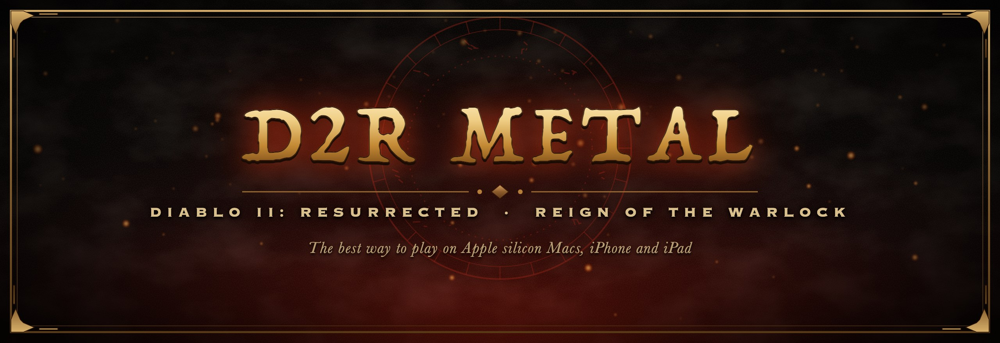
</p>

<p align="center">
  
  
  
  
  <a href="https://github.com/PowerBeef/d2r-metal/releases/latest"></a>
  
</p>

<h3 align="center">The best way to play Diablo II: Resurrected on Apple silicon Macs, iPhone and iPad.</h3>

D2R Metal turns your own copy of **Diablo II: Resurrected with Reign of the Warlock** into a native app for your Mac, iPhone or iPad. The game's own code runs directly on your Apple chip, and every frame is drawn with Metal 4: Sanctuary is sharp at your screen's full resolution and smooth at 60 fps, with controls made for each device, and it plays fully offline. It isn't an emulator, a stream or a remake. It is Blizzard's game, as it shipped.

You need your own copy of the **Nintendo Switch version** of the game; D2R Metal builds itself from your files and contains none of the game.

<p align="center"><b><a href="https://github.com/PowerBeef/d2r-metal/releases/latest">Download D2R Metal Launcher</a></b> for the Mac &nbsp;·&nbsp; <a href="#getting-started">Getting started</a> &nbsp;·&nbsp; <a href="#questions-and-answers">Questions and answers</a></p>

<p align="center">
  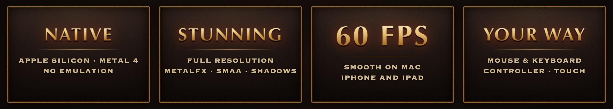
</p>

<h2 align="center" id="stunning-on-every-screen">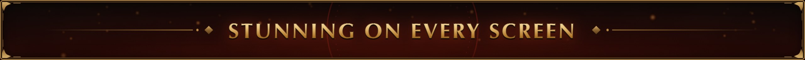</h2>

D2R Metal draws the game for the screen in front of you. The first time it starts on a Mac, it looks at the Mac's graphics chip and screen and turns on as much as it estimates the Mac can keep at a steady 60 fps. iPhone and iPad start from one set of settings, the same on every device, tested on an iPhone 17 Pro. Those settings are listed as **Recommended** in the game's Options, and you can change any of them ([Picture settings](#picture-settings)).

- **Sharp at your screen's resolution.** On a Mac the interface and text are drawn at the resolution macOS draws your display at, up to 4K. A larger screen (5K or 6K, or a 4K one set to look like 2560 × 1440) gets the 4K picture enlarged, and a Mac too light for its screen's full resolution starts with a smaller picture enlarged by MetalFX. On iPhone and iPad they are drawn at the screen's full resolution. The 3D world is drawn at full resolution on the fastest Macs, and lower, enlarged by MetalFX, on lighter Macs, iPhone and iPad.
- **MetalFX.** When the 3D world is drawn below your screen's resolution, Apple's upscaler enlarges it with far more detail than a plain stretch.
- **Clean edges and crisp ground.** The game's PC anti-aliasing (SMAA) and 16x texture filtering keep edges smooth and the ground sharp into the distance.
- **Shadows everywhere.** On the Mac, trees, walls, fences and buildings cast their shadows as on PC, and finer shadow maps keep the shading on characters detailed.
- **True colors.** The picture is shown in the colors the game was made in, on any screen, wide-gamut ones included.
- **Dark places you can see.** Caves, crypts, Hell and night scenes are drawn brighter than the game's own exposure, with highlights left as they are. Turn off **Brighten dark areas** on the Extras tab for the original look.

The pictures below show the same moment in the game: on the left, the Nintendo Switch version your files come from; on the right, D2R Metal. They are windows of the frame at 1:1 pixels, so on a Retina screen you see every pixel of both.

<p align="center">
  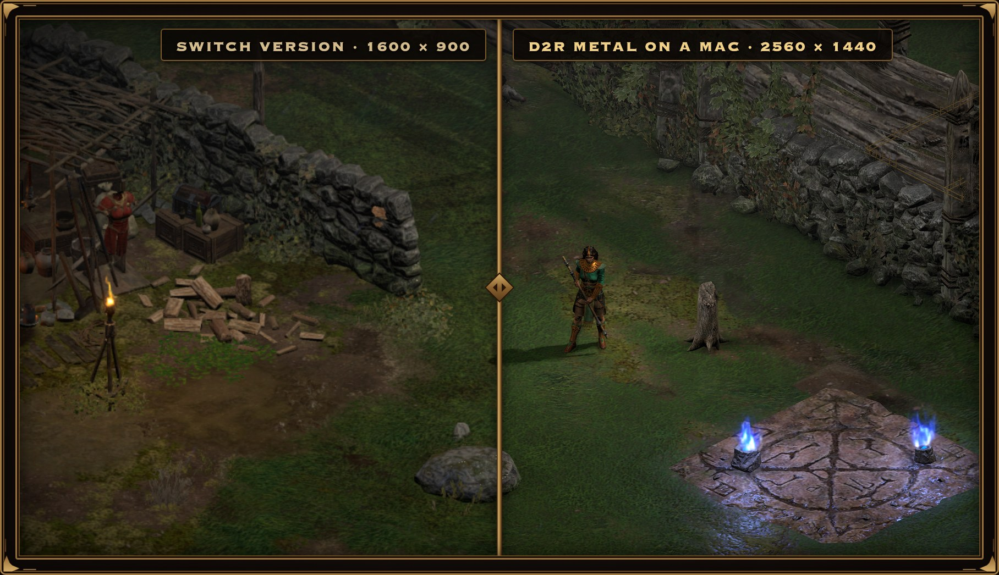
</p>

<p align="center"><sub><b>On a Mac with a 2560 × 1440 screen.</b> Left: the Switch version's docked picture (1600 × 900), enlarged to the screen as a TV or monitor would. Right: D2R Metal with the settings it picked for this Mac: everything drawn at 2560 × 1440 with the 3D world at full resolution, SMAA, 16x filtering, environment shadows and fine shadow maps.</sub></p>

<p align="center">
  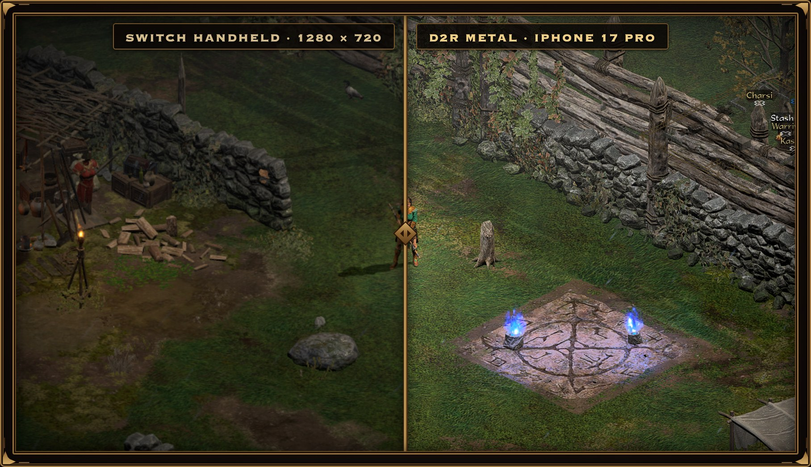
</p>

<p align="center"><sub><b>On an iPhone 17 Pro.</b> Left: the Switch version's handheld picture (1280 × 720), enlarged to the phone's screen. Right: D2R Metal at its iPhone and iPad Recommended settings (the same on every iPhone and iPad): the 3D world at 75% enlarged by MetalFX, with SMAA and 16x filtering, at 60 fps on this phone (drawn by the iOS app at the phone's resolution and settings).</sub></p>

<h2 align="center" id="across-sanctuary">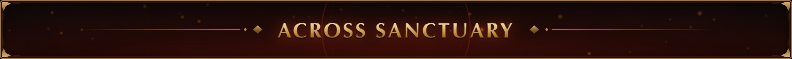</h2>

One stop in every act: the Switch version on the left, D2R Metal on a Mac on the right, the same moment at 1:1 pixels. The Switch side keeps the game's own exposure; D2R Metal brightens caves, crypts, Hell and nights by default (**Brighten dark areas** on the Extras tab), which is why the Catacombs and the River of Flame look lighter on the right. Each pair is taken at the same time of day in the game on both sides.

<p align="center">
  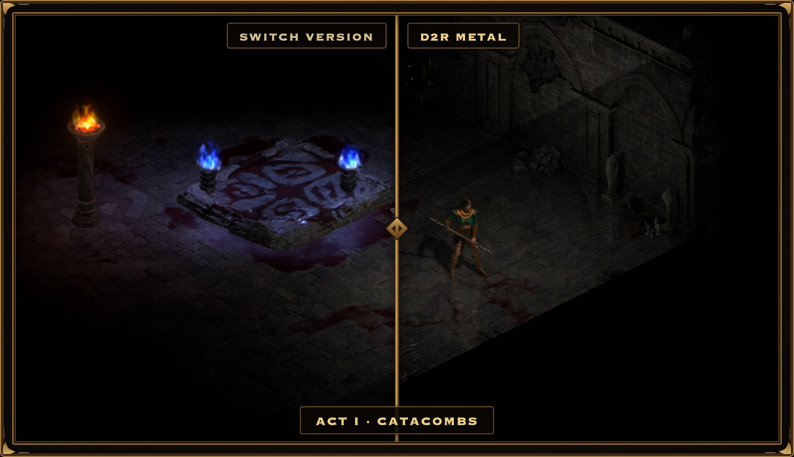
</p>
<p align="center">
  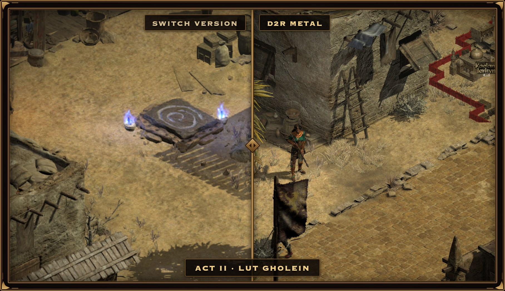
</p>
<p align="center">
  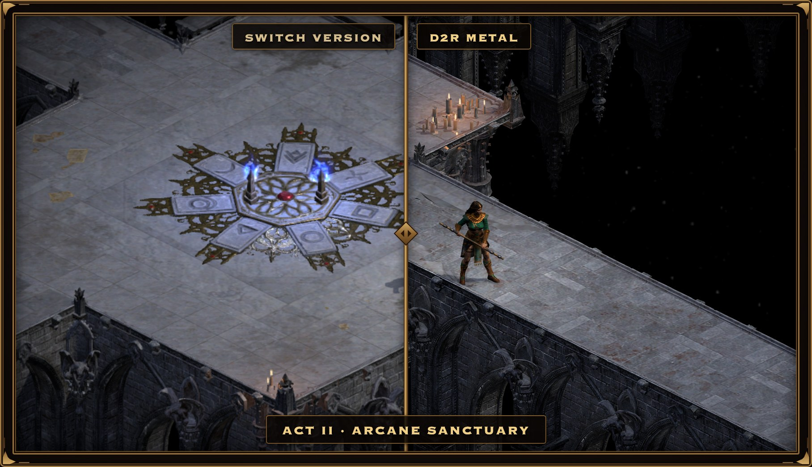
</p>
<p align="center">
  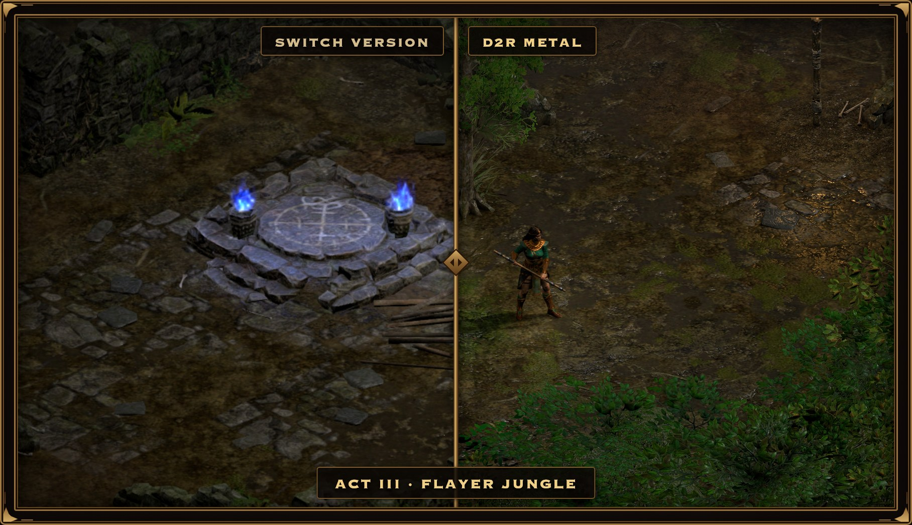
</p>
<p align="center">
  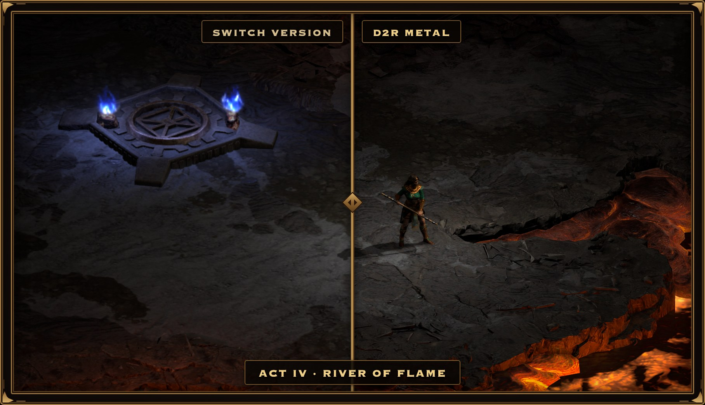
</p>
<p align="center">
  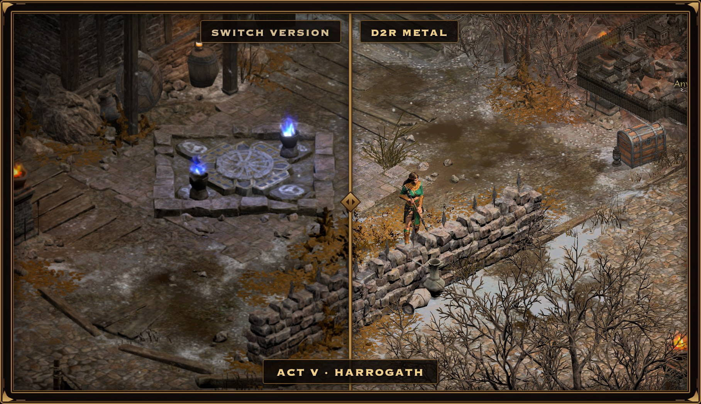
</p>

**More of Sanctuary in D2R Metal:**

<p align="center">
  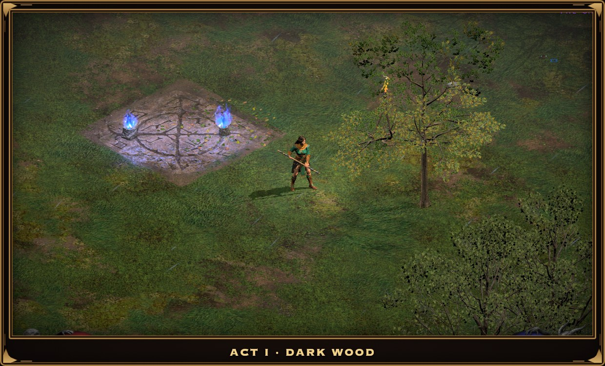
  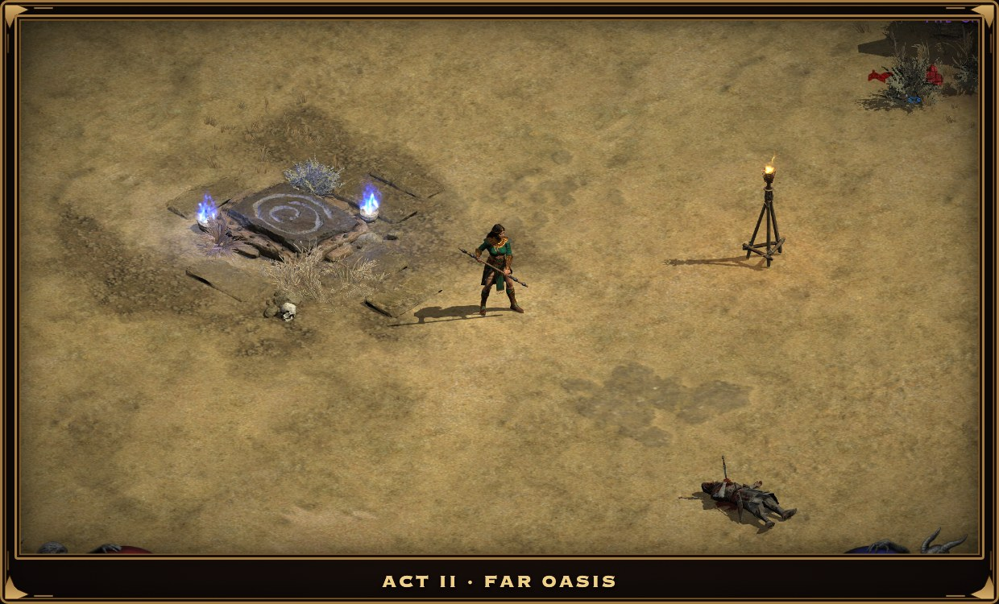
  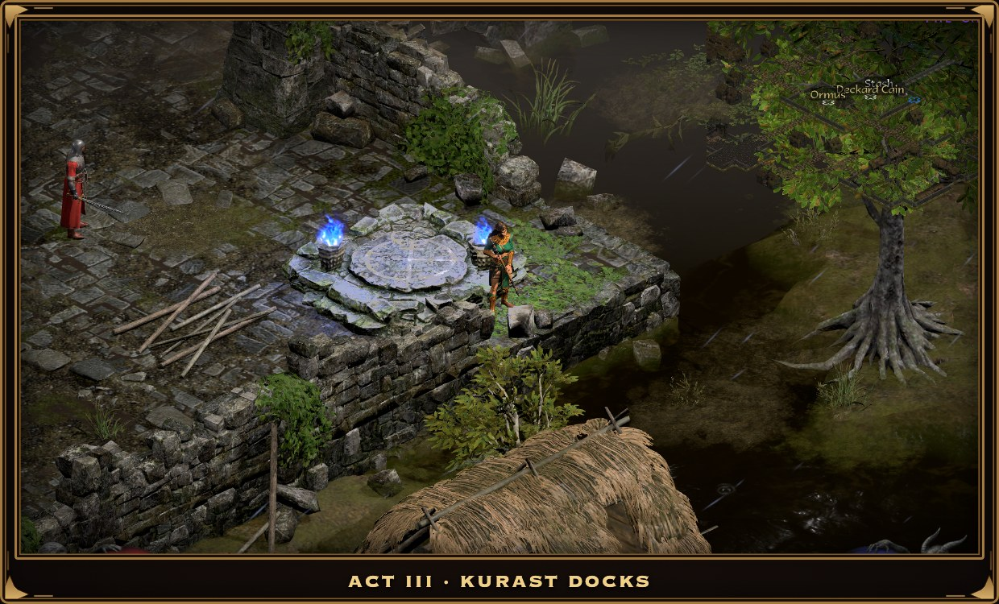
  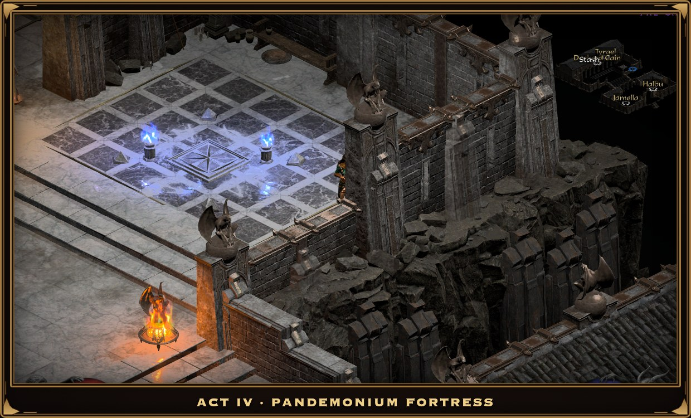
  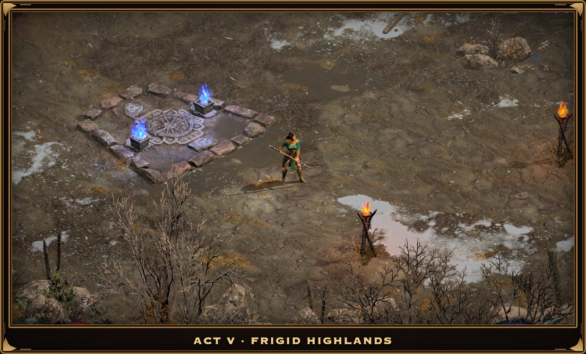
  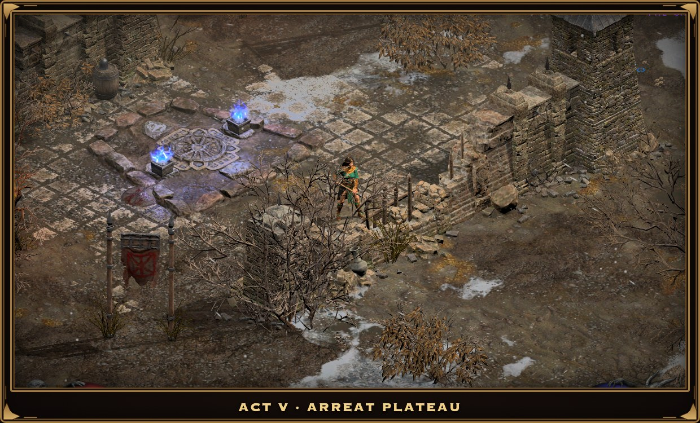
</p>

<h2 align="center" id="a-true-mac-game">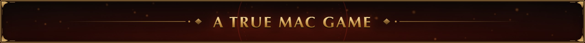</h2>

**Plays like D2R on PC.** With a mouse and keyboard you get the game's own PC interface: the PC HUD with the angel and demon beside the orbs, the PC menus and character screens, and the game's gauntlet pointer, sized to your screen. The keys are D2R's PC defaults:

- click to walk, attack, talk and pick up, and hold to keep going; right click casts your right skill at the pointer, or uses the item under it;
- Shift + click attacks without moving, and holding Shift compares an item with what you wear;
- 1 – 4 drink from the belt, F1 – F8 pick skills, and the wheel steps through them;
- I, C, T and Q open and close the inventory, character, skill tree and quests; Tab shows the map, Alt the items on the ground, W swaps weapons;
- Esc closes what is open, or opens the game menu.

The inventory, stash, vendors and the cube are worked with the mouse, and item descriptions use the PC wording ("Right Click to Use"). Keys can't be rebound yet.

<p align="center">
  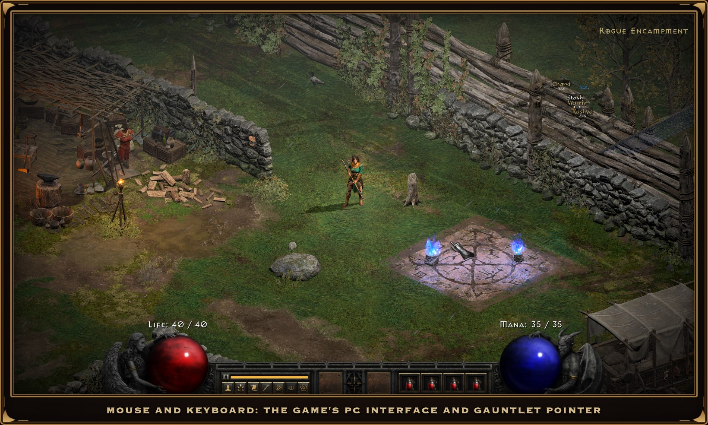
  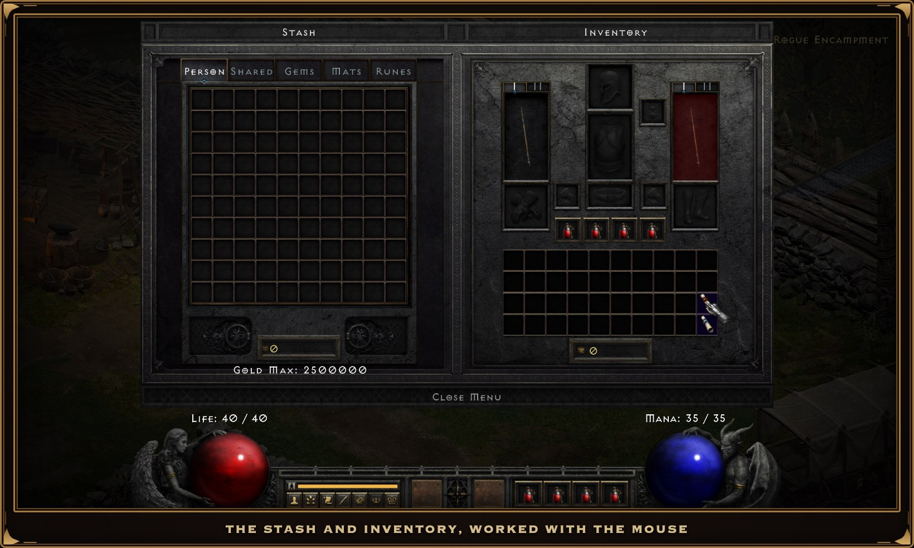
</p>

**Or pick up a controller.** Press a button and the console interface comes up, with button hints for what you hold: Xbox, PlayStation or Switch. Move the mouse or press a key and the PC interface returns. Naming a character or entering an amount of gold with a controller brings up an in-game keyboard in the game's own style.

<p align="center">
  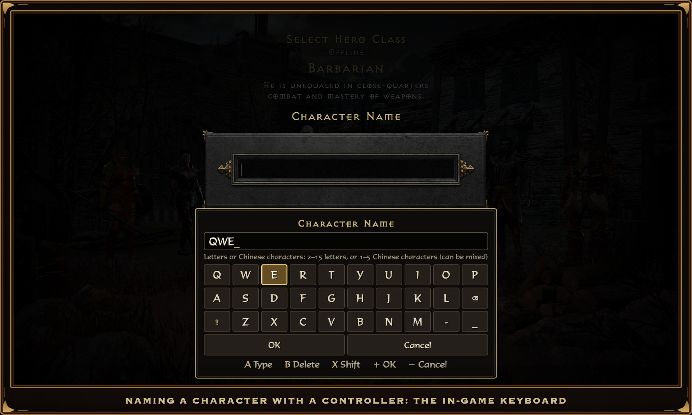
</p>

- **Full screen at your display's own resolution** from the first launch. View → Full Screen (⌃⌘F) switches, and the App remembers it. The window can be resized freely, and the picture fills it.
- **It saves like a Mac app should:** on every quit, from the Dock, at logout, even with a text box open.
- **The wheel and trackpad scroll** the game's lists, and scroll bars and sliders drag.
- **iCloud save sync** with your iPhone or iPad comes with a Mac App you build and sign yourself with a paid developer account; the App the launcher installs keeps its saves on the Mac, and moving a character over by hand takes a minute ([docs/MAC.md](docs/MAC.md#saves-logs-and-icloud)).

Everything about playing on the Mac (keys, mouse, saves, iCloud) is in [docs/MAC.md](docs/MAC.md).

<h2 align="center" id="made-for-iphone-and-ipad">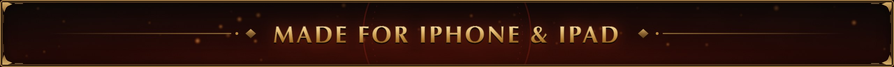</h2>

- **Touch controls made for the game,** or a controller with the game's own console interface.
- **The same sharp picture on the go:** the 3D world enlarged by MetalFX, with SMAA, 16x filtering and true colors. The 3D resolution can go from 50 to 100%.
- **Smooth when the action gets busy:** the 3D resolution dips for a moment while frames drop, then comes back. A 30 fps setting saves battery.
- **Saves when the app goes to the background,** so swiping it away loses nothing, and **iCloud sync** carries your characters between devices.
- **Older iPhones and iPads** (A14 to A16) play with a [Legacy Device Pack](docs/LEGACY_DEVICES.md). They start from the same picture settings as the newest iPhones, not yet tested on these devices: if the game drops frames, lower 3D Resolution or set Anti-Aliasing to FXAA (Options → Video).

For now the iPhone and iPad app is built from source with Xcode ([Getting started](#on-iphone-and-ipad-or-to-develop-build-from-source)).

| At a glance | Mac | iPhone / iPad |
|---|---|---|
| Controls | Mouse and keyboard as on PC, trackpad, controller | Touch, controller |
| Picture | Up to your screen's own resolution, at most 4K | Your screen's full resolution |
| 3D world | Up to full resolution, enlarged by MetalFX below it | 50–100%, enlarged by MetalFX |
| Environment shadows | On where the Mac is expected to hold 60 fps with them | Available, off by default |
| Saves | On every quit and when minimized | When sent to the background |
| Install | D2R Metal Launcher | Build from source with Xcode |
| System | macOS 27 or later | iOS / iPadOS 27 or later |

<h2 align="center" id="getting-started">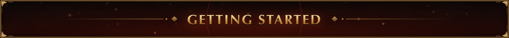</h2>

**What you need:**

- an **Apple silicon Mac** (M1 or later) on macOS 27, or an **iPhone or iPad** on iOS / iPadOS 27 ([supported devices](#supported-devices));
- **your own copy of the game**: the Nintendo Switch version of Diablo II: Resurrected with the Reign of the Warlock expansion, updated to 1.0.34.0, dumped from your own console. How to get the files is in [docs/GAME_FILES.md](docs/GAME_FILES.md).

> This project provides only tools and contains no game content. We do not distribute or endorse, and are not responsible for, any third party distributing game assets, game executables or install packages that contain game content. Please use only game files you legally own.

### On a Mac: D2R Metal Launcher

1. **Download** `D2R-Metal-Launcher-<version>.dmg` from the [latest release](https://github.com/PowerBeef/d2r-metal/releases/latest), open it and drag **D2R Metal Launcher** to Applications. It is signed and notarized by Apple.
2. **Choose your game files:** the game packages (`.nsp` or `.xci`: the base game and the 1.0.34.0 update) with your console's `prod.keys`, or a folder you already extracted.
3. **Press Install.** The launcher builds the game on your Mac from your own files, in about 10–15 minutes the first time. Then press **Play**.

From then on the launcher opens the game, updates it and itself when a new version is out (the game's main menu tells you too), can go back to the previous version, and repairs an install. It needs about 30 GB free while installing, and nothing else to install. More in [docs/LAUNCHER.md](docs/LAUNCHER.md).

### On iPhone and iPad, or to develop: build from source

The iPhone and iPad app, a Mac App with iCloud sync, and development all build from this repository on a Mac with Xcode 27:

1. **Put your game files in the workspace** (default `~/dm-work`, or set `DM_ROOT`):

   ```
   ~/dm-work/data/switch/3.3.94012/Update/ExeFS/    main, sdk, subsdk0
   ~/dm-work/data/switch/3.3.94012/Update/RomFS/    data/…
   ```

   `./setup.sh <packages…> <prod.keys>` extracts them from your game packages for you.

2. **Prepare the workspace.** This checks your tools, rewrites the game program and translates the game's shaders to Metal; the first run takes a while. `./setup.sh check` reports what is missing and what to run next.

   ```bash
   ./setup.sh
   source ~/dm-work/build/cache/dm/venv/bin/activate
   ```

3. **Build the app.**

   - **iPhone / iPad**: copy `dm/ios/local.env.example` to `dm/ios/local.env` and set your signing details (`DM_TEAM_ID`, `DM_BUNDLE_ID`; with a free Apple ID also `DM_FREE_ACCOUNT=1` and `DM_IOS_UDID`), then `cd dm/ios && ./run.sh build && ./run.sh install`. On first launch the app asks for the game resource folder ([docs/GAME_FILES.md](docs/GAME_FILES.md)).
   - **Mac**: `dm/tools/mac_app.sh` produces `~/dm-work/out/macapp/D2R Metal.app`. No developer account needed; with a paid one it can carry iCloud sync. See [docs/MAC.md](docs/MAC.md#build-from-source).

Run `./setup.sh` again after updating to a new commit. It also rewrites three files that depend on your local tools (`dm/gfx/tools/dmsh_chain.lock`, `dm/gfx/nvn/dmsh_chain.h`, `dm/gfx/nvn/c1_full.tsv`); that is expected, don't commit them. The full dependency list is in [docs/DEPENDENCIES.md](docs/DEPENDENCIES.md).

<h2 align="center" id="supported-devices">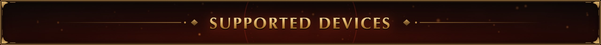</h2>

D2R Metal draws with Metal 4, which needs an **M1 or A14 chip** or later, and runs on **macOS 27 and iOS / iPadOS 27** or later.

| Device | Plays? | What you need |
|---|---|---|
| Mac, M1 or later | Yes | macOS 27 or later |
| MacBook Neo (A18 Pro) | Should; not tried on one yet (starts with lighter shadows) | macOS 27 or later |
| iPhone / iPad, A17 Pro or M chip | Yes | iOS / iPadOS 27 or later |
| iPhone / iPad, A14–A16 | Yes | iOS / iPadOS 27 or later, and a [Legacy Device Pack](docs/LEGACY_DEVICES.md) |
| A13 and older, Intel Macs | No | — |

A17 Pro means iPhone 15 Pro and later and iPhone 16 and later; A14–A16 covers the iPhone 12 to 14 families and the iPhone 15 / 15 Plus. Devices with 4 GB of memory run, but tightly. Older systems (macOS 15–26, iOS 18–26), Apple TV, Android and HarmonyOS are not supported. Every iPhone and iPad starts from the same picture settings, tested on an iPhone 17 Pro only ([Picture settings](#picture-settings)).

<h2 align="center" id="picture-settings">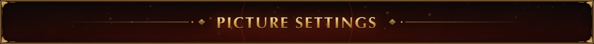</h2>

Every setting lives in the game's own Options, on five tabs: **Video**, **Audio**, **Gameplay**, **Settings** and **Extras**.

**Recommended** is the set of picture settings D2R Metal picks for your device the first time it starts:

- **On a Mac,** it looks at the graphics chip (its generation and how many graphics cores it has) and at your screen, and turns on as much as it estimates the Mac can hold at 60 fps (or at the faster rate of a 144 Hz screen). Fast Macs get the 3D world at full resolution with every effect on. Lighter Macs, such as most MacBook Airs, get the 3D world at a lower resolution enlarged by MetalFX, often without environment shadows and with Standard shadows, and their 3D resolution dips for a moment when the action gets busy instead of stuttering. It works this out again when you change screens. The estimate rests on public benchmarks of each chip; [docs/MAC.md](docs/MAC.md#what-recommended-picks) has examples.
- **On iPhone and iPad,** the same on every device: the 3D world at 75% enlarged by MetalFX, with SMAA, 16x filtering and true colors, and Frame Drops set to lower the 3D resolution for a moment while frames drop. They were tested on an iPhone 17 Pro; on an older iPhone or iPad, lower 3D Resolution or set Anti-Aliasing to FXAA if the game drops frames.

You can change any setting; **Graphic Presets** also offers *Performance* (lighter) and *Quality* (on a Mac everything on; on iPhone and iPad the 3D world at 100% with MetalFX, SMAA and 16x filtering, the shadow rows left as they are), and **Default** puts the tab you are on back to Recommended.

- **Video**:
  - On the Mac: Display Mode, Resolution (1600 × 900 to 2560 × 1440, or Native), Color (Accurate / Vivid), Graphic Presets, 3D Resolution (100 down to 50%) and Upscaling (Standard / MetalFX).
  - On iPhone and iPad: 3D Resolution (50 to 100%), Color, Graphic Presets and Upscaling.
  - On both: **Anti-Aliasing** (FXAA or SMAA), **Anisotropic Filtering** (Original up to 16x), **Environment Shadows** and **Shadow Quality** (Standard up to Ultra; both take effect at the next start), **Frame Rate** (60 fps, or 30 to save power; 72 or 36 on a 144 Hz Mac screen) and **Frame Drops** (lower the 3D resolution while frames drop, or keep it).
- **Settings** holds the game's own **Offline Difficulty Scaling**, which sets the player count and takes effect at once.
- **Apply, Discard and Default** work like the game's own option pages.

<p align="center">
  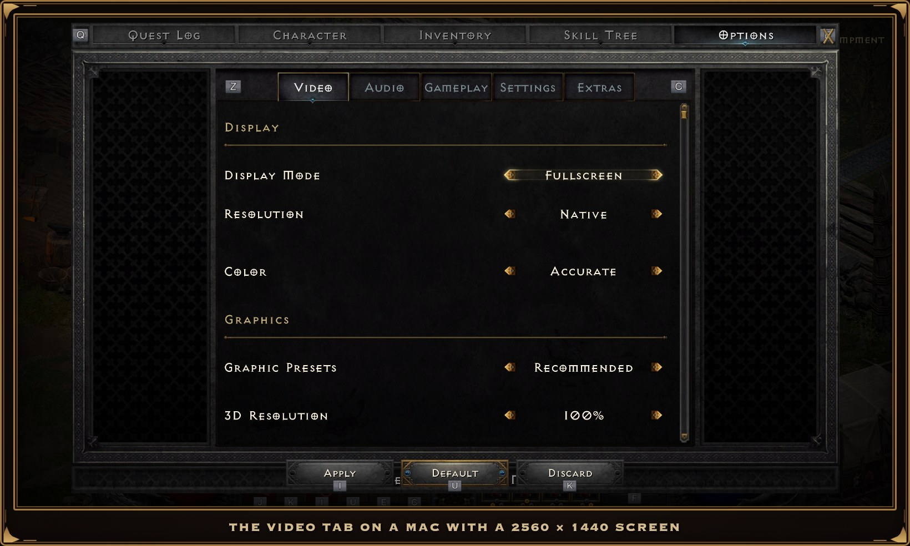
  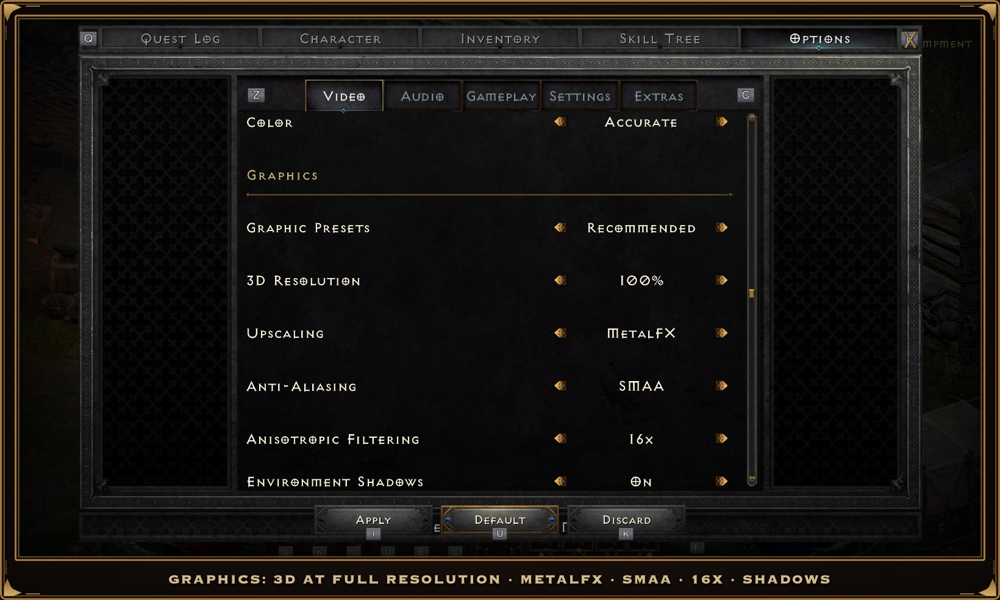
</p>
<p align="center">
  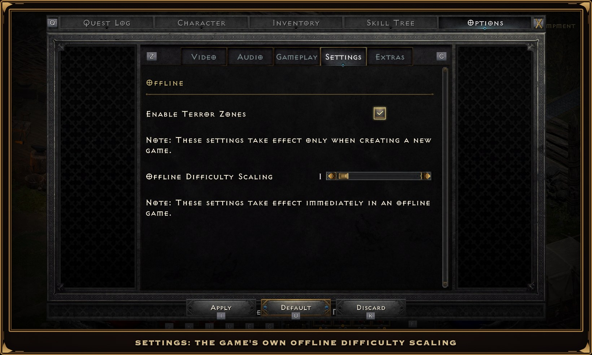
</p>

<h2 align="center" id="saves-you-can-trust">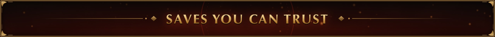</h2>

- The Mac App saves on every quit, including from the Dock, at logout and with a text box still open; minimizing is treated like an iPhone going to the background.
- The iPhone app saves when it goes to the background, so swiping it away doesn't lose progress.
- A failed save (a full disk, for example) is refused with a message, and the next one goes through: one failure can't silently stop every later save.
- A damaged shared stash can't hang iCloud sync.

These came out of a full audit of the port, a bug hunt with sanitizers and Metal validation, and a study of how the game itself saves.

<h2 align="center" id="the-game-as-it-shipped">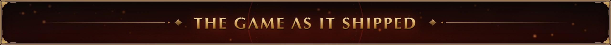</h2>

> **D2R Metal changes the platform, not the game.**

The rules, drop rates, economy, skills and their caps, the stash with its tabs, the automap and the difficulty are the ones Blizzard shipped, with no gameplay systems added on top. The game's logic is left alone apart from the part of a community fix that lets it run offline.

A few conveniences sit on the **Extras** tab of Options, each one a switch you can turn off: light beams on valuable drops, brighter dark areas, item notes, potion pickup and belt refill, and a buzz on valuable drops (iPhone). A new game starts beside the town's waypoint, and the pause menu has **Quick Restart** (save, exit and rejoin with the same character and difficulty).

<h2 align="center" id="questions-and-answers">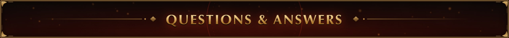</h2>

**Is this an emulator?** No. The game's own code, from the Switch release, runs directly on your Apple chip; only the handful of instructions an ordinary app can't run are rewritten ahead of time, and the Switch's graphics are rebuilt on Metal 4. Nothing is streamed.

**Do I need a Switch?** You need your own copy of the Switch version of the game and its update, dumped from your own console with its keys ([docs/GAME_FILES.md](docs/GAME_FILES.md)). D2R Metal contains no game files and never will.

**I own the PC (Battle.net) version. Can I use it?** No, D2R Metal is built on the Switch release. On a Mac, CrossOver runs the PC version.

**Can I play online?** No, D2R Metal plays offline only.

**Does it work on my Mac?** Any Mac with Apple silicon (M1 or later) on macOS 27 or later. The game picks its picture settings for your Mac the first time it starts. Intel Macs aren't supported.

**How do updates work?** The launcher checks this project's releases, updates the game and itself, and can go back to the previous version. The game's main menu also tells you when a new version is out.

**Coming from D2R Mobile?** Its saves load here. Items kept in its extra stash space (the wider columns, extra pages, Pouch or vault) don't carry over.

<h2 align="center" id="for-developers">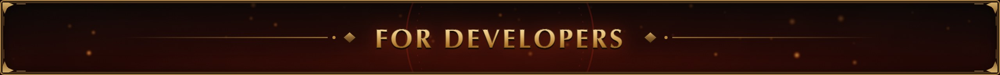</h2>

<details>
<summary><b>How it works</b></summary>

1. An offline step rewrites a few instructions in the game's aarch64 program so it can run as an ordinary process (no code is generated at run time, which iOS forbids).
2. A native host loads it, provides the Switch system services it calls, and runs it on the device's CPU.
3. The game's NVN graphics calls are replayed on Metal 4, with its shaders translated offline to Metal.

A tour of the code is in [dm/README.md](dm/README.md).

</details>

<details>
<summary><b>Built to be measured</b></summary>

<p align="center">
  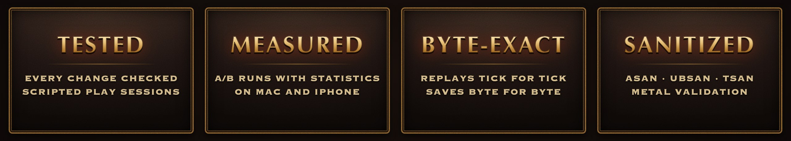
</p>

Every change is checked before it lands, and the numbers below come from runs that can be repeated. One command runs the checks in tiers, from a few seconds of source checks to long soak runs: `dm/verify/fork_gate.sh` ([dm/verify/FORK_GATE.md](dm/verify/FORK_GATE.md)). Picture-neutral changes are checked against tick-identical replays, FLIP pixel comparisons of this Mac's Recommended, the iPhone's and the original pictures, and structural checks of the interface pages; costs are measured with alternating A/B runs.

The tools in the repository:

- a **control port** to drive a running game, and a **scenario runner** that plays scripted sessions on the command-line host, the Mac App, the iOS app on a Mac, or an iPhone ([control_port.md](dm/verify/control_port.md), [scenarios](dm/verify/scenarios/README.md));
- **checks that read the game's own state**: the panels on screen, the focused widget, the controller actions as the game names them, and the save system, where a save that never commits is a failure; every scripted session also checks that its saved game would load;
- **baselines recorded from this project's own build**: three routes replay tick for tick, the replayed saves match the recorded ones byte for byte, and key screens are compared;
- **save fault tests** (a full disk at different moments, a quit in the middle of a save), a **playtest bot** that checks invariants after every action, and long **soak** runs;
- **A/B benchmarks** with statistics, regression checks against a kept build, sampled profiles per game thread and function, per-pass GPU timing, and **frame capture and replay**;
- **sanitizer builds** (ASan, UBSan, TSan), seeded **random exploration** with shrinking, **replay**, and LLDB commands that read the game's panels, focus and saves ([debugging.md](dm/verify/debugging.md)).

Measured on Apple hardware ("edge sharpness" is the edge variance of the whole captured frame: one number for how much contrast its edges have; higher is crisper, and it only compares frames of the same scene):

- **Mac with an M6 chip, the settings D2R Metal picks for it** (town and combat routes, 2 runs each): Native 2560 × 1440 with the 3D world at full resolution and every effect on holds 60 fps, with no slow frames in town and 0.05% in the combat route's walk (GPU time per frame p50 8.4 ms, p95 12.1 ms in town), and so does Native 3840 × 2160 on the town route (p50 12.4 ms, p95 14.1 ms). This GPU lowers its clock when it has room, so its time per frame barely moves with the 3D resolution (8.4 → 6.6 ms from 100% to 50%) and cannot rank the settings' costs on a fast Mac; the settings for other chips are estimated from public GPU benchmarks per chip ([docs/MAC.md](docs/MAC.md)).
- **Mac with an M6 chip, the 3D world at 75%** (2560 × 1440 screen, town route, 6 + 6 alternating runs): Native output with the 3D at 75% + MetalFX takes about the same GPU time per frame as 1920 × 1080 + MetalFX (game frame 6.1 → 7.5 ms, present 1.7–2.1 → 0.3–0.4 ms). The game's SMAA added about 0.5 ms before the shader change below, and 16x filtering adds about 0.2 ms; both are GPU time at the lowered clock this GPU runs at when it has room, so they are relative sizes, not costs. Letting rendering passes overlap saves 0.54 ms (−8.5%). Skipping repeated state binds cuts bind records by 57% and the replay thread's instructions by 13%.
- **Mac, SMAA** (4 + 4 alternating runs): building the anti-aliasing shaders without the HDR curve the game computes and then discards here cut the SMAA edge pass from 0.68 to 0.31 ms and the GPU time per frame from 7.25 to 6.72 ms, with a captured frame replaying pixel-identical ([e070b94](https://github.com/PowerBeef/d2r-metal/commit/e070b94)).
- **Mac, environment shadows** (M6, town route, 3 + 3 alternating runs): scenery shadows add about 0.5 ms of GPU time per frame in town (6.78 → 7.32 ms) and 0.25 ms in the Blood Moor, with 60 fps and no dropped frames either way ([4f952ed](https://github.com/PowerBeef/d2r-metal/commit/4f952ed)).
- **Mac, MetalFX at the last step** (M6, 12 GPU cores, 2560 × 1440 screen, character select): enlarging the same 1600 × 900 picture costs 0.28 ms of GPU time with a plain stretch and 1.38 ms with MetalFX; edge sharpness goes from 235 to 569 ([4ac0543](https://github.com/PowerBeef/d2r-metal/commit/4ac0543)).
- **iPhone, MetalFX on the 3D world** (iPhone 17 Pro, 3D at 75%: 1967 × 905 inside a 2622 × 1206 frame): steady 60 fps; edge sharpness 404 → 728 with the same colors ([7c2f892](https://github.com/PowerBeef/d2r-metal/commit/7c2f892)). Its GPU time per frame is no cost measurement: this phone's GPU time fills the frame (see below).
- **iPhone, SMAA and 16x filtering** (iPhone 17 Pro standing in town, 3D at 75%, runs alternated, 110 s each): both hold 60 fps with frame time p95 17.6 ms, CPU per frame about 16 ms and the thermal state the same as without them. The phone doesn't show their GPU cost to an app: its GPU slows its clock until each frame's work fills the frame (about 15 ms whatever the setting), and the process energy reading follows the CPU.
- Not measured yet: any Mac slower than the M6; any iPhone or iPad other than the iPhone 17 Pro (all of them start from the same Recommended); battery and heat on phones over long sessions; and the shadow settings on a phone (environment shadows, and the Switch's own 2100-pixel shadow map, which phones now use too).

</details>

<details>
<summary><b>History</b></summary>

- D2R Metal began in October 2026 as a fork of D2R Mobile. Its first changes went back upstream (four were adopted in D2R Mobile v2.0); since 2026-10-28 it is developed on its own, for Apple platforms only.
- **1.0** (2026-10-31) is the first release, with D2R Metal Launcher for the Mac. Releases are listed on the [releases page](https://github.com/PowerBeef/d2r-metal/releases).
- **1.1** (2026-11-02) plays with a mouse and keyboard as D2R does on PC: the game's own PC interface, gauntlet pointer and PC keys; a controller brings the console interface back.
- **1.2** (2026-11-03) picks the picture settings for your Mac from its chip and screen.
- `main` is the trunk. Changes are checked by the project's own gate ([dm/verify/FORK_GATE.md](dm/verify/FORK_GATE.md)); see [CONTRIBUTING.md](CONTRIBUTING.md).

</details>

<p align="center"></p>

## Legal

**You must own the game, including the Reign of the Warlock expansion.** This is an independent, non-commercial project. It is not affiliated with, endorsed by, or sponsored by Blizzard Entertainment, Nintendo or Apple. Diablo and Blizzard Entertainment are trademarks of Blizzard Entertainment, Inc.; Nintendo Switch is a trademark of Nintendo; Apple, Mac, iPhone, iPad, Metal and MetalFX are trademarks of Apple Inc. Use it only with a copy of the game that you own. The banner, plaques, section plates, frames and ornaments on this page are original artwork made for this project; they use no art from the game. The screenshots show the game running in D2R Metal; they live with this page in `docs/images` and are not part of any release.

## Acknowledgements

D2R Metal exists because of **[D2R Mobile](https://github.com/jhaizhou-ops/d2r-mobile)** by [@jhaizhou-ops](https://github.com/jhaizhou-ops) and its contributors, who built the port: the original program running unchanged, touch controls, controller support and five languages. Their acknowledgements, including the community authors of the Android and HarmonyOS ports, are in upstream's README.

The project stands on the open-source work below. Thank you to its authors and maintainers.

- **Ryujinx** (Ryubing Canary 1.3.351, MIT): `dm/third_party/ryujinx` bundles its shader translator unchanged (the Ryujinx.Graphics.Shader, Spv.Generator and Ryujinx.Common projects), which translates the Switch game's shaders to SPIR-V.
- **deko3d** (fincs, devkitPro, zlib): the texture layout size algorithm in `dm/gfx/nvn/nvn_tex.c` is ported from it; the file carries deko3d's notice.
- **nvn.h** (h1k421, MIT): the graphics API declarations in `dm/gfx/nvn/include/nvn.h`.
- **nxnative** (seedds, MIT): GPU timestamps, the 120 Hz display-link timing, the Metal compile cache, the shader bounds guard, NVN frame capture and replay, the function-map and fuzzing tools are adapted from it; each adapted file says so in its header.
- The full texts of these two licenses are in [dm/third_party/notices](dm/third_party/notices), and every release pack that carries the adapted code carries them too.
- **libdeflate** (Eric Biggers, MIT): decompressing game data.
- **bcdec** (iOrange, MIT or Unlicense): decoding BC textures on devices that do not support the BC formats.
- **FLIP** (NVIDIA, BSD 3-Clause): the image difference metric used in image-quality checks.
- **Offline fix patch** (LFS Mod Offline Fix): the two rewrites in `dm/tools/patch_nso.py` that let the game run offline come from this community patch, whose original author is not reliably recorded. Its two other byte patches change game logic and are left out.
- Tools used to build and verify: SPIRV-Cross, XcodeGen, .NET, Capstone and Unicorn, Pillow, numpy, lz4, astcenc, hactool, libimobiledevice and LLVM. Versions and links are in [docs/DEPENDENCIES.md](docs/DEPENDENCIES.md).

## License

MIT, see [LICENSE](LICENSE) (Copyright (c) 2026 jhaizhou; Copyright (c) 2026 the d2r-metal contributors). Third-party code keeps its own license in its own directory; see [docs/DEPENDENCIES.md](docs/DEPENDENCIES.md).
