<p align="center">
  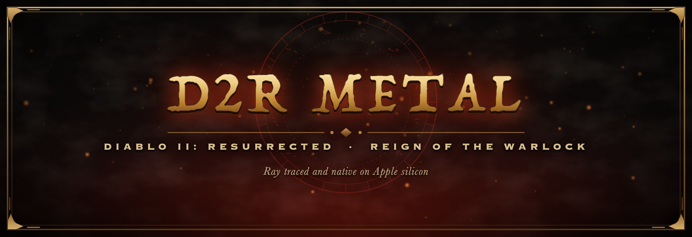
</p>

<h3 align="center">Diablo II: Resurrected on your Mac, iPhone and iPad. Native, ray traced, and yours to play offline.</h3>

<p align="center">
  <a href="https://github.com/PowerBeef/d2r-metal/releases/latest"></a>
  <a href="#getting-started"></a>
</p>

<p align="center">
  <a href="https://github.com/PowerBeef/d2r-metal/releases/latest"></a>
  
  
  
  
  <a href="#getting-started"></a>
</p>

<p align="center">
  <picture><source media="(max-width: 700px)" srcset="docs/images/r3-clip-cath-s.avif" type="image/avif"><source srcset="docs/images/r3-clip-cath.avif" type="image/avif">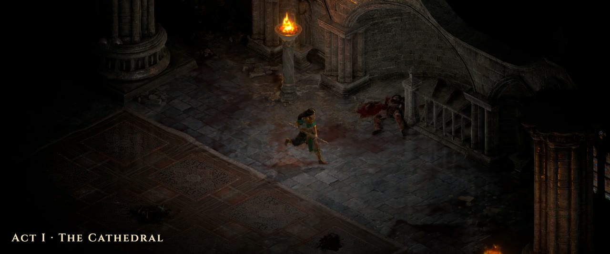</picture>
</p>

Sanctuary belongs on Apple silicon. D2R Metal brings **Diablo II: Resurrected with Reign of the Warlock** to your Mac, iPhone and iPad as a real native game: Blizzard's own code running on your chip, drawn by Metal 4, with ray-traced light on Macs that can carry it. No emulator, no streaming, no remake, no account, no internet. Just the Rogue Encampment waiting for you.

> ### 🎮 You need your own copy of the game, the Nintendo Switch version.
> D2R Metal is not the game. It's the port: it builds itself from the files of **your own Switch copy of Diablo II: Resurrected with Reign of the Warlock**, dumped from your own console, and it ships none of the game. The Battle.net PC version can't be used. [How to get your files ready →](docs/GAME_FILES.md)

<p align="center">
  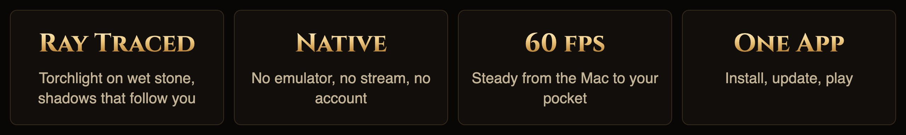
</p>

<h2 align="center" id="ray-traced-sanctuary">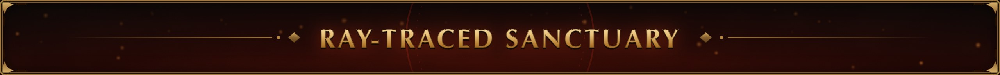</h2>

You know these places. Now walk them with the light traced through them: torches that throw your shadow across the Cathedral floor, flagstones that have never been this wet, and dark that is still properly dark. Rays sit on top of the game's own lighting, the way its artists meant it, and show best where the torches do the work. Every clip is the game as it runs on a Mac mini with an M6, at the settings it chose for itself, rays at Full.

<p align="center">
  <picture><source media="(max-width: 700px)" srcset="docs/images/r3-clip-harem-s.avif" type="image/avif"><source srcset="docs/images/r3-clip-harem.avif" type="image/avif">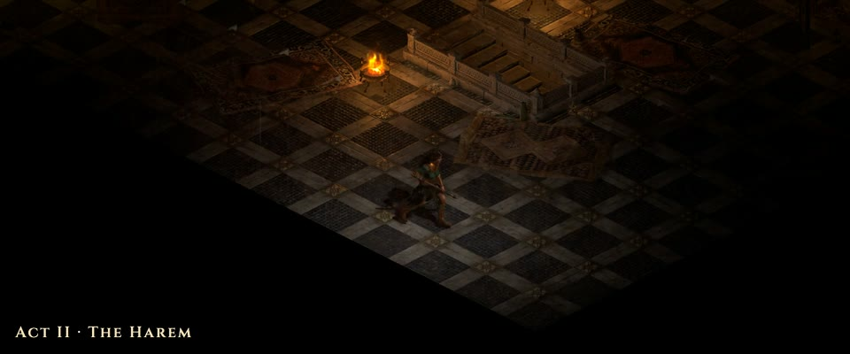</picture>
  <picture><source media="(max-width: 700px)" srcset="docs/images/r3-clip-sewer-s.avif" type="image/avif"><source srcset="docs/images/r3-clip-sewer.avif" type="image/avif">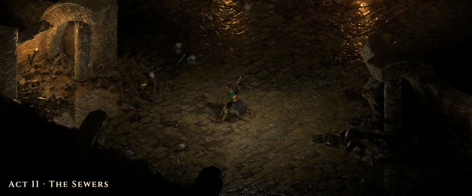</picture>
</p>
<p align="center">
  <picture><source media="(max-width: 700px)" srcset="docs/images/r3-clip-wstone-s.avif" type="image/avif"><source srcset="docs/images/r3-clip-wstone.avif" type="image/avif">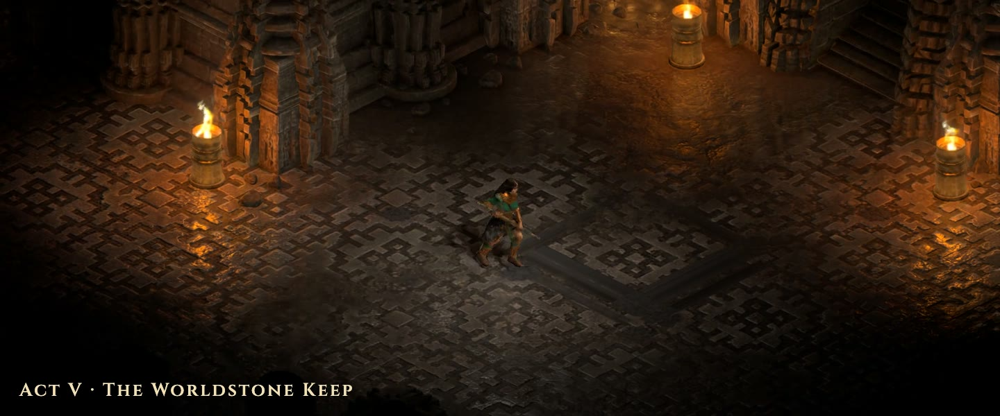</picture>
  <picture><source media="(max-width: 700px)" srcset="docs/images/r3-clip-glacial-s.avif" type="image/avif"><source srcset="docs/images/r3-clip-glacial.avif" type="image/avif">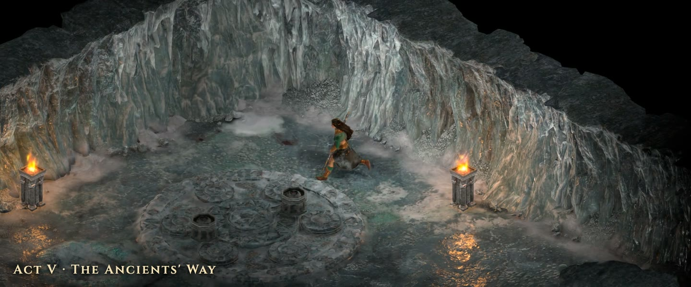</picture>
</p>

- **Every surface answers the light its own way.** Marble, ice and steel catch the glow around them as you move. The Sewers and the Catacombs glisten; the desert stays dry; the Durance of Hate stays black.
- **Your shadow is real.** Torches, braziers and your own character throw ray-traced shadows that swing as you pass.
- **Shade settles where it should,** at the foot of walls, under ledges, between the stones, and the sun's shadows are traced across the Blood Moor too.

Ray tracing has four levels, **Off, Light, Standard and Full**, and switches instantly. It needs a Mac with an M3 or later; the game turns it on by itself where your Mac can hold 60 fps ([which Macs](#supported-devices)). iPhone and iPad don't have it yet. The torch glints on polished floors are the game's own effect lights, turned up with Environment Detail, so the lighter levels keep them.

<h2 align="center" id="across-sanctuary"></h2>

<p align="center">
  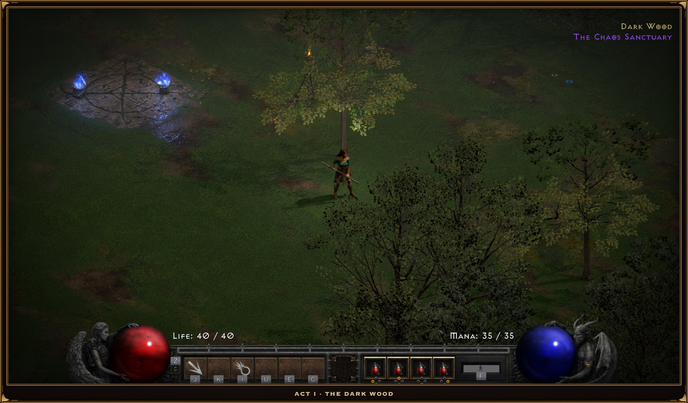
  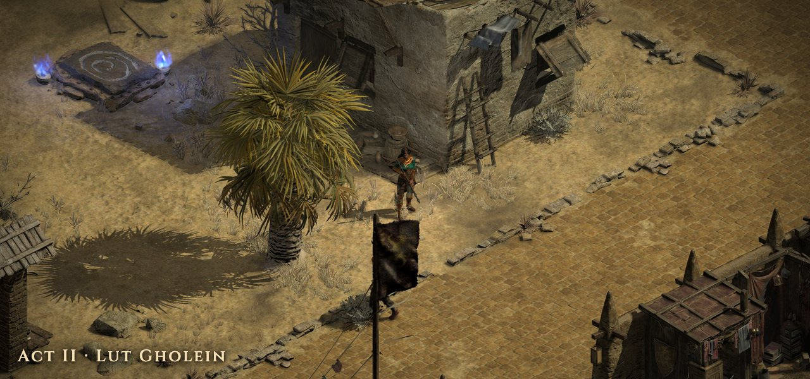
  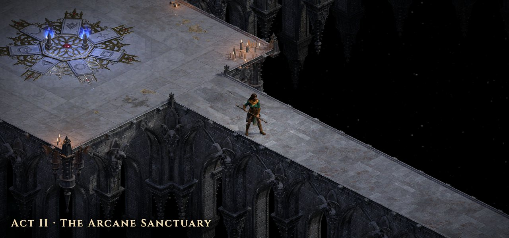
  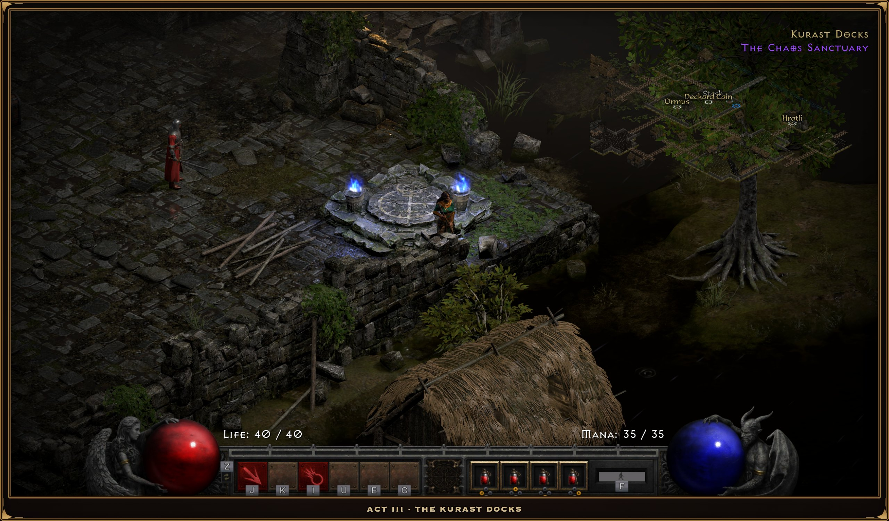
  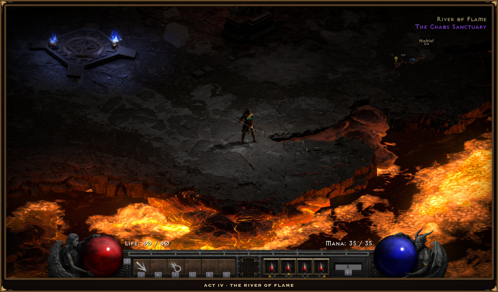
  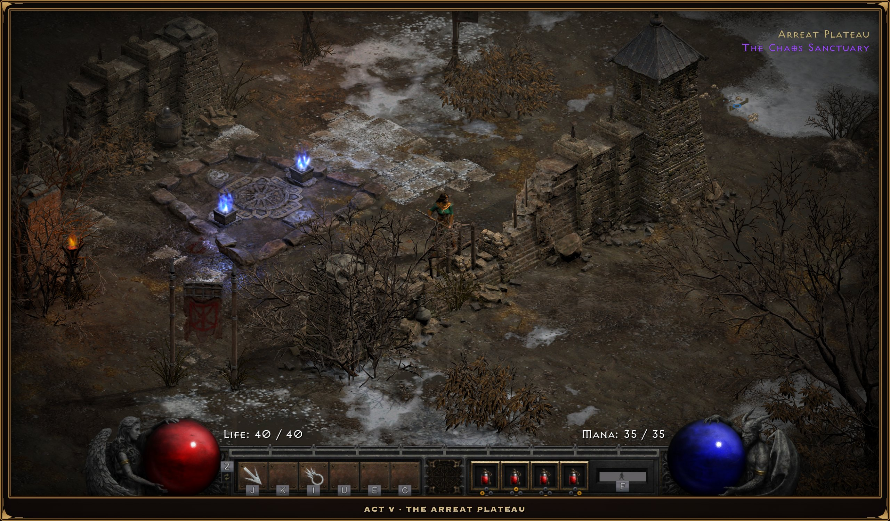
</p>

<h2 align="center" id="built-for-apple-silicon">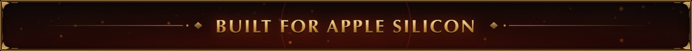</h2>

This isn't a Windows game squeezed through a translation layer. It's Diablo II, rebuilt from the inside for the hardware you own.

- **Blizzard's code, your chip.** The game runs directly on Apple silicon, with nothing in between to slow it or break it.
- **Metal 4, and only Metal 4.** The graphics were rebuilt from scratch for Apple's newest graphics API, with no older code path dragging behind.
- **MetalFX in every frame.** Apple's upscaler rebuilds detail from several frames and creates the frames in between, so the game can spend its time on light instead of pixels. Text and panels stay pin sharp.
- **Hardware ray tracing** on the M3 and later, the way Apple designed it to be used.
- **It sets itself up.** The first time it opens, it reads your chip, your screen, your memory and even whether your Mac has a fan, and picks the picture to match. Change screens and it works it out again.

<h2 align="center" id="smooth-by-design">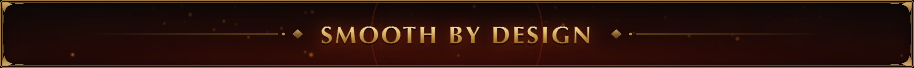</h2>

Diablo II lives on its rhythm: the click, the swing, the loot hitting the ground. D2R Metal draws 30 frames a second and MetalFX builds the 30 between, so your eye sees a steady 60 while every drawn frame gets twice the time. That's what pays for the rays. Here's what a play session looks like on screen: a flat line is a game that never stutters.

<p align="center">
  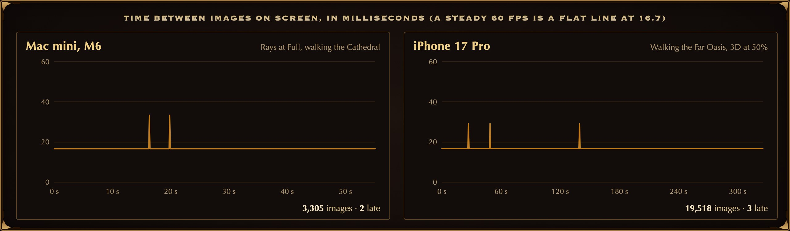
</p>

<sub>One session each, skipping the first 5 seconds while the area loads in. These are the two devices we've measured ourselves. Honest footnote: with 100 monsters on screen the iPhone 17 Pro dips to about 54 fps, and generated frames add a touch of input delay, about 22 ms on an M6. Nothing a Baal run will notice.</sub>

<h2 align="center" id="the-launcher"></h2>

No terminal, no scripts, no wiki page of steps. On the Mac you download one app, **D2R Metal Launcher**, show it your game files, press **Install**, and a coffee later you press **Play**.

<p align="center">
  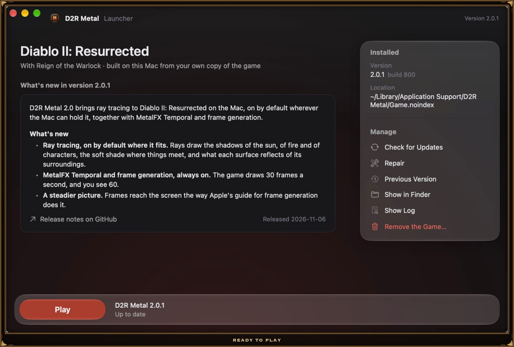
</p>
<p align="center">
  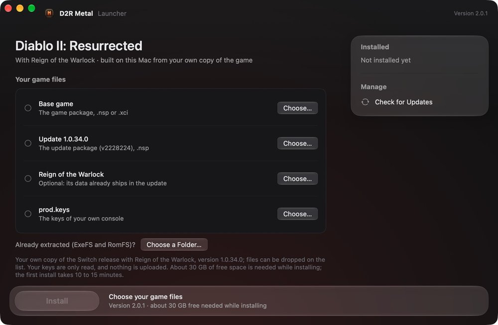
  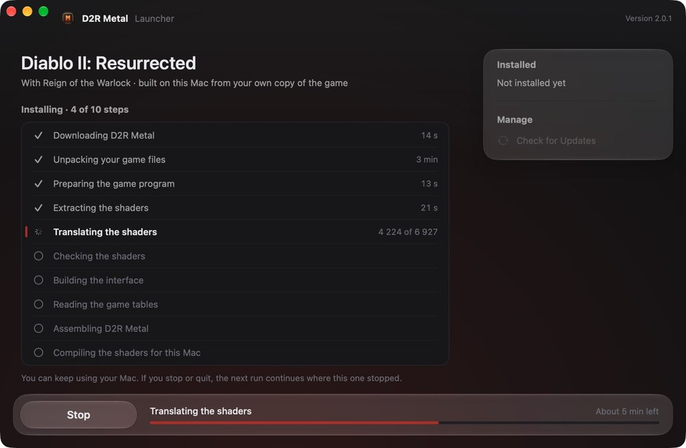
</p>

- **Builds the game on your Mac,** from your own files, in about 10 to 15 minutes the first time. Nothing is uploaded anywhere.
- **Keeps you current.** New version out? It tells you, updates itself and the game in a few minutes, and never touches your characters.
- **Has your back.** It can roll back to the previous version, repair a damaged install, and it's signed and notarized by Apple so macOS just opens it.

<h2 align="center" id="play-your-way">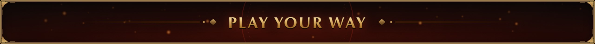</h2>

| Mouse and keyboard | Controller | Touch |
|---|---|---|
| The real PC interface, the gauntlet pointer and the keys you already know | The console interface, with the right button hints for Xbox, PlayStation or Switch | Controls built for the game, on iPhone and iPad |

Pick up a controller mid-game and the console interface appears; touch the mouse and the PC one is back. No menu to visit.

<p align="center">
  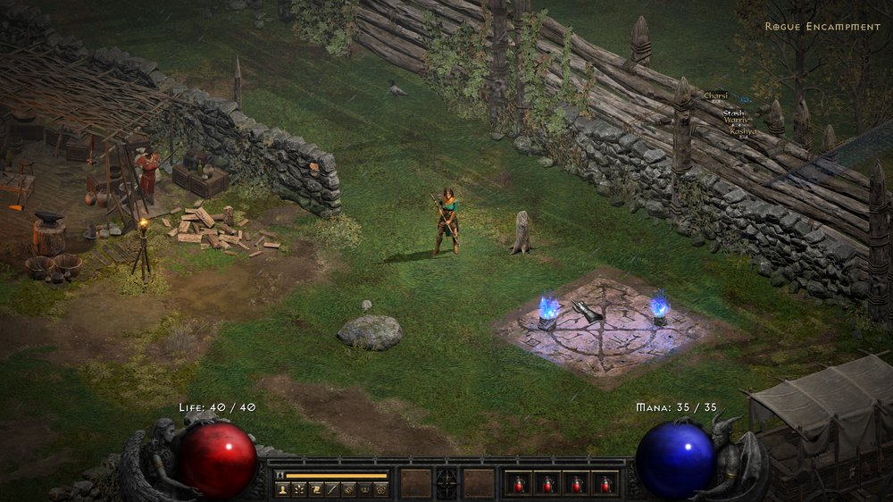
  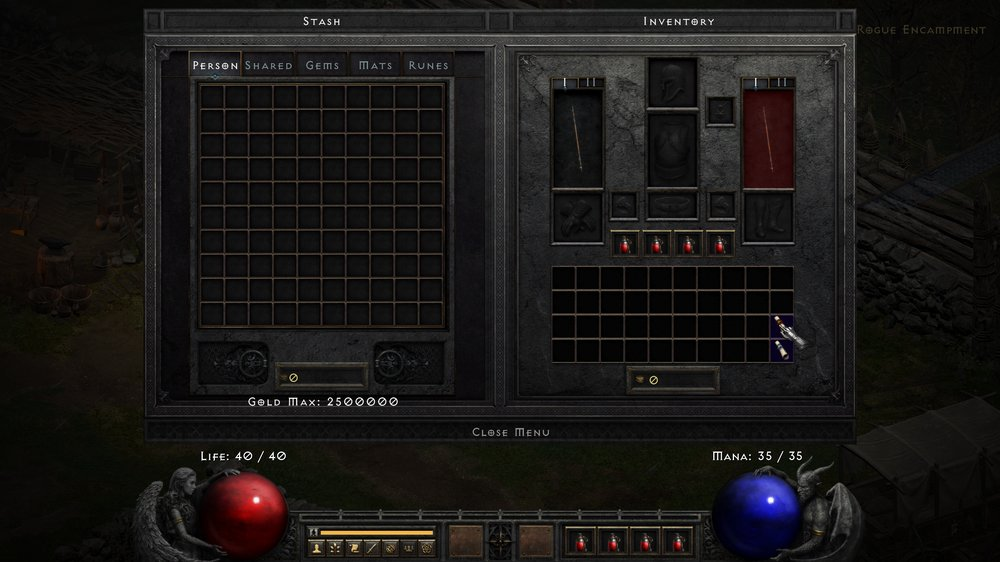
</p>

<details>
<summary><b>The keys</b></summary>

They're D2R's own PC defaults, so your hands already know them:

- Click to walk, attack, talk and pick up; hold to keep going. Right click casts your right skill, or uses the item under the pointer.
- Shift + click attacks without moving. Hold Shift over an item to compare it with what you wear.
- 1 to 4 drink from the belt, F1 to F8 pick skills, the wheel steps through them.
- I, C, T and Q for inventory, character, skills and quests. Tab for the map, Alt to show the loot on the ground, W to swap weapons, Esc to close things or open the menu.

Rebinding isn't in yet. Everything else about the Mac version is in [docs/MAC.md](docs/MAC.md).

</details>

<h2 align="center" id="made-for-iphone-and-ipad"></h2>

<p align="center">
  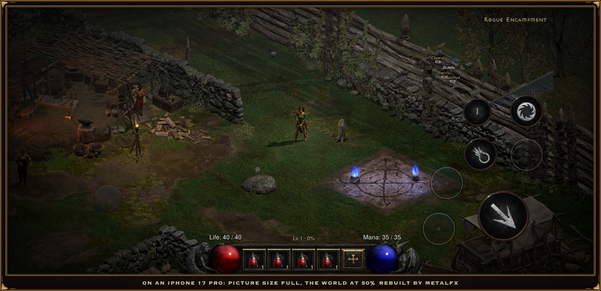
</p>

The whole game, in your pocket, with touch controls made for it or any controller you pair. MetalFX rebuilds the world from half size so your phone stays cool and the frames stay steady, and each iPhone and iPad gets a picture size its chip can carry. It saves the moment you swipe away, and iCloud carries your characters between your devices. For now the iPhone and iPad app is built from source with Xcode ([how](#on-iphone-and-ipad-or-to-develop-build-from-source)).

<h2 align="center" id="supported-devices"></h2>

**You need:** a Mac with an M1 or later on macOS 27, or an iPhone or iPad with an A14 or later on iOS / iPadOS 27. **For ray tracing,** an M3 or later. Below is what the game picks for each device the first time it starts; you can change all of it in Options.

#### Mac

Each cell shows the ray tracing level and how wide the 3D world is drawn, in pixels, on that chip's usual screen. Two lines mean the bigger GPU option, then the smaller. The M6 is on a 2560 × 1440 display.

| | M6 | M5 | M4 | M3 | M2 | M1 |
|---|:---:|:---:|:---:|:---:|:---:|:---:|
| **Ultra**<br><sub>4K display</sub> | – | **Full**&nbsp;3840 | – | **Full**&nbsp;3840 | Off&nbsp;3840 | Off&nbsp;3840 |
| **Max**<br><sub>16-inch</sub> | – | **Full**&nbsp;3456 | **Full**&nbsp;3456 | **Full**&nbsp;3456<br>**Full**&nbsp;2938 | Off&nbsp;3456 | Off&nbsp;3456 |
| **Pro**<br><sub>14-inch</sub> | – | **Full**&nbsp;3024 | **Full**&nbsp;2570 | **Standard**&nbsp;2268<br>**Light**&nbsp;2026 | Off&nbsp;3024 | Off&nbsp;3024<br>Off&nbsp;2570 |
| **Base**<br><sub>13-inch Air</sub> | **Full**&nbsp;2560 ✓ | **Light**&nbsp;1970<br>Off&nbsp;2500 | Off&nbsp;2500<br>Off&nbsp;1470 | Off&nbsp;1970<br>Off&nbsp;1920 | Off&nbsp;1470<br>Off&nbsp;1920 | Off&nbsp;1600 |

Every Mac also gets MetalFX, frame generation, 16x filtering, true colors, environment shadows and the finest shadow maps, except the 7-core M1 and the MacBook Neo (A18 Pro: no rays, 1204 wide), which get lighter shadows. **✓ marks the one Mac we've measured ourselves.** The rest are our best estimates from public benchmarks, and could be a notch off either way ([how we pick](docs/MAC.md#what-recommended-picks)). If your Mac has room to spare or struggles, nudge the 3D Resolution and Ray Tracing rows, and [tell us](https://github.com/PowerBeef/d2r-metal/issues/new/choose) what you've got.

<h4 id="iphone-and-ipad">iPhone and iPad</h4>

Every iPhone and iPad gets MetalFX, frame generation, the world at half size, 16x filtering and true colors. What changes from one device to the next is the Picture Size.

| Picture Size | iPhone | iPad |
|---|---|---|
| **Full**<br><sub>screen's own</sub> | 18 Pro, 18 Pro Max, 17 Pro ✓, 17 Pro Max, 17 ≈, SE (3rd gen) | Pro 13 M5, Pro 11 M5 M4 M2, Air 11 M4 M3 |
| **High**<br><sub>75% of rows</sub> | Air, 17e, 16 Pro ≈, 16 Pro Max, 16, 16 Plus, 16e ≈, 15 Pro ≈ | Pro 13 M4, Pro 12.9 M2, Pro 11 M1, Air 13 M4 M3 M2, Air 11 M2, Air M1 |
| **Medium**<br><sub>62.5%</sub> | 15 Pro Max, 15 ≈, 15 Plus, 14 Pro ≈, 14 Pro Max, 14 ≈, 13 Pro ≈ | Pro 12.9 M1, mini A17 Pro, iPad A16 |
| **Low**<br><sub>720 rows</sub> | 14 Plus, 13 Pro Max, 13 ≈, 13 mini, 12 Pro Max, 12 Pro ≈, 12 ≈, 12 mini | mini A15, iPad A14, Air A14 |

> **✓** we played it on that very device (only the iPhone 17 Pro so far). **≈** we simulated it on the iPhone 17 Pro, slowing its graphics to match that chip: each one held 60 fps in town, but a real phone's slower processor could still dip in a big fight. **No mark:** an estimate from benchmarks, never run. Own one of these? [Tell us](https://github.com/PowerBeef/d2r-metal/issues/new/choose) how it plays.

iPhones and iPads with an A14 to A16 chip also need a one-time [Legacy Device Pack](docs/LEGACY_DEVICES.md), and the 4 GB models run with little room to spare.

<details>
<summary><b>Every device in detail</b></summary>

| Chip | GPU cores | Usual screen | Picture | World | Ray Tracing | Shadows |
|---|---|---|---|---|---|---|
| **M6, measured** | 12 | 2560 × 1440 display | 2560 × 1440 | 2560 × 1440 <sub>100%</sub> | **Full** | Environment, Ultra |
| M5 Ultra | 64, 80 | 4K display | 3840 × 2160 | 3840 × 2160 <sub>100%</sub> | **Full** | Environment, Ultra |
| M5 Max | 32, 40 | 16-inch MacBook Pro | 3456 × 2160 | 3456 × 2160 <sub>100%</sub> | **Full** | Environment, Ultra |
| M5 Pro | 16, 20 | 14-inch MacBook Pro | 3024 × 1890 | 3024 × 1890 <sub>100%</sub> | **Full** | Environment, Ultra |
| M5 | 8 | 13-inch MacBook Air | 2940 × 1838 | 2500 × 1562 <sub>85%</sub> | Off | Environment, Ultra |
| M5 | 10 | 13-inch MacBook Air | 2940 × 1838 | 1970 × 1232 <sub>67%</sub> | **Light** | Environment, Ultra |
| M4 Max | 32, 40 | 16-inch MacBook Pro | 3456 × 2160 | 3456 × 2160 <sub>100%</sub> | **Full** | Environment, Ultra |
| M4 Pro | 16, 20 | 14-inch MacBook Pro | 3024 × 1890 | 2570 × 1606 <sub>85%</sub> | **Full** | Environment, Ultra |
| M4 | 8 | 13-inch MacBook Air | 2940 × 1838 | 1470 × 920 <sub>50%</sub> | Off | Environment, Ultra |
| M4 | 10 | 13-inch MacBook Air | 2940 × 1838 | 2500 × 1562 <sub>85%</sub> | Off | Environment, Ultra |
| M3 Ultra | 60, 80 | 4K display | 3840 × 2160 | 3840 × 2160 <sub>100%</sub> | **Full** | Environment, Ultra |
| M3 Max | 30 | 16-inch MacBook Pro | 3456 × 2160 | 2938 × 1836 <sub>85%</sub> | **Full** | Environment, Ultra |
| M3 Max | 40 | 16-inch MacBook Pro | 3456 × 2160 | 3456 × 2160 <sub>100%</sub> | **Full** | Environment, Ultra |
| M3 Pro | 14 | 14-inch MacBook Pro | 3024 × 1890 | 2026 × 1266 <sub>67%</sub> | **Light** | Environment, Ultra |
| M3 Pro | 18 | 14-inch MacBook Pro | 3024 × 1890 | 2268 × 1418 <sub>75%</sub> | **Standard** | Environment, Ultra |
| M3 | 8 | 13-inch MacBook Air | 1920 × 1200 <sub>enlarged</sub> | 1920 × 1200 <sub>100%</sub> | Off | Environment, Ultra |
| M3 | 10 | 13-inch MacBook Air | 2940 × 1838 | 1970 × 1232 <sub>67%</sub> | Off | Environment, Ultra |
| M2 Ultra | 60, 76 | 4K display | 3840 × 2160 | 3840 × 2160 <sub>100%</sub> | Off | Environment, Ultra |
| M2 Max | 30, 38 | 16-inch MacBook Pro | 3456 × 2160 | 3456 × 2160 <sub>100%</sub> | Off | Environment, Ultra |
| M2 Pro | 16, 19 | 14-inch MacBook Pro | 3024 × 1890 | 3024 × 1890 <sub>100%</sub> | Off | Environment, Ultra |
| M2 | 8 | 13-inch MacBook Air | 1920 × 1200 <sub>enlarged</sub> | 1920 × 1200 <sub>100%</sub> | Off | Environment, Ultra |
| M2 | 10 | 13-inch MacBook Air | 2940 × 1838 | 1470 × 920 <sub>50%</sub> | Off | Environment, Ultra |
| M1 Ultra | 48, 64 | 4K display | 3840 × 2160 | 3840 × 2160 <sub>100%</sub> | Off | Environment, Ultra |
| M1 Max | 24, 32 | 16-inch MacBook Pro | 3456 × 2160 | 3456 × 2160 <sub>100%</sub> | Off | Environment, Ultra |
| M1 Pro | 14 | 14-inch MacBook Pro | 3024 × 1890 | 2570 × 1606 <sub>85%</sub> | Off | Environment, Ultra |
| M1 Pro | 16 | 14-inch MacBook Pro | 3024 × 1890 | 3024 × 1890 <sub>100%</sub> | Off | Environment, Ultra |
| M1 | 7 | 13-inch MacBook Air | 1600 × 1000 <sub>enlarged</sub> | 1600 × 1000 <sub>100%</sub> | Off | Standard |
| M1 | 8 | 13-inch MacBook Air | 1600 × 1000 <sub>enlarged</sub> | 1600 × 1000 <sub>100%</sub> | Off | Environment, Ultra |
| A18 Pro | 5 | MacBook Neo | 2408 × 1506 | 1204 × 752 <sub>50%</sub> | Off | Standard |

| Device | Chip | Screen | Picture Size | Picture | World | How we know |
|---|---|---|---|---|---|---|
| iPhone 18 Pro | A20 Pro | 2622 × 1206 | Full | 2622 × 1206 | 1311 × 603 | Estimated |
| iPhone 18 Pro Max | A20 Pro | 2868 × 1320 | Full | 2868 × 1320 | 1434 × 660 | Estimated |
| iPhone 17 Pro | A19 Pro | 2622 × 1206 | Full | 2622 × 1206 | 1311 × 603 | **Measured** |
| iPhone 17 Pro Max | A19 Pro | 2868 × 1320 | Full | 2868 × 1320 | 1434 × 660 | Estimated |
| iPhone 17 | A19 | 2622 × 1206 | Full | 2622 × 1206 | 1311 × 603 | Simulated |
| iPhone Air | A19 Pro | 2736 × 1260 | High | 2054 × 946 | 1027 × 473 | Estimated |
| iPhone 17e | A19 | 2532 × 1170 | High | 1900 × 878 | 950 × 439 | Estimated |
| iPhone 16 Pro | A18 Pro | 2622 × 1206 | High | 1966 × 904 | 983 × 452 | Simulated |
| iPhone 16 Pro Max | A18 Pro | 2868 × 1320 | High | 2152 × 990 | 1076 × 495 | Estimated |
| iPhone 16 | A18 | 2556 × 1179 | High | 1916 × 884 | 958 × 442 | Estimated |
| iPhone 16 Plus | A18 | 2796 × 1290 | High | 2098 × 968 | 1049 × 484 | Estimated |
| iPhone 16e | A18 | 2532 × 1170 | High | 1900 × 878 | 950 × 439 | Simulated |
| iPhone 15 Pro | A17 Pro | 2556 × 1179 | High | 1916 × 884 | 958 × 442 | Simulated |
| iPhone 15 Pro Max | A17 Pro | 2796 × 1290 | Medium | 1746 × 806 | 873 × 403 | Estimated |
| iPhone 15, iPhone 14 Pro | A16 | 2556 × 1179 | Medium | 1596 × 736 | 798 × 368 | Simulated |
| iPhone 15 Plus, iPhone 14 Pro Max | A16 | 2796 × 1290 | Medium | 1746 × 806 | 873 × 403 | Estimated |
| iPhone 14, iPhone 13 Pro | A15 | 2532 × 1170 | Medium | 1584 × 732 | 792 × 366 | Simulated |
| iPhone 14 Plus, iPhone 13 Pro Max | A15 | 2778 × 1284 | Low | 1558 × 720 | 779 × 360 | Estimated |
| iPhone 13 | A15 | 2532 × 1170 | Low | 1558 × 720 | 779 × 360 | Simulated |
| iPhone 13 mini | A15 | 2340 × 1080 | Low | 1560 × 720 | 780 × 360 | Estimated |
| iPhone SE (3rd gen) | A15 | 1334 × 750 | Full | 1334 × 750 | 667 × 375 | Estimated |
| iPhone 12 Pro Max | A14 | 2778 × 1284 | Low | 1558 × 720 | 779 × 360 | Estimated |
| iPhone 12 Pro, iPhone 12 | A14 | 2532 × 1170 | Low | 1558 × 720 | 779 × 360 | Simulated |
| iPhone 12 mini | A14 | 2340 × 1080 | Low | 1560 × 720 | 780 × 360 | Estimated |
| iPad Pro 13, M5 | M5 | 2752 × 2064 | Full | 2752 × 2064 | 1376 × 1032 | Estimated |
| iPad Pro 11, M5 | M5 | 2420 × 1668 | Full | 2420 × 1668 | 1210 × 834 | Estimated |
| iPad Pro 13, M4 | M4 | 2752 × 2064 | High | 2064 × 1548 | 1032 × 774 | Estimated |
| iPad Pro 11, M4 | M4 | 2420 × 1668 | Full | 2420 × 1668 | 1210 × 834 | Estimated |
| iPad Pro 12.9, M2, iPad Air 13, M2 | M2 | 2732 × 2048 | High | 2050 × 1536 | 1025 × 768 | Estimated |
| iPad Pro 11, M2 | M2 | 2388 × 1668 | Full | 2388 × 1668 | 1194 × 834 | Estimated |
| iPad Pro 12.9, M1 | M1 | 2732 × 2048 | Medium | 1708 × 1280 | 854 × 640 | Estimated |
| iPad Pro 11, M1 | M1 | 2388 × 1668 | High | 1792 × 1252 | 896 × 626 | Estimated |
| iPad Air 13, M4 | M4 | 2732 × 2048 | High | 2050 × 1536 | 1025 × 768 | Estimated |
| iPad Air 11, M4 | M4 | 2360 × 1640 | Full | 2360 × 1640 | 1180 × 820 | Estimated |
| iPad Air 13, M3 | M3 | 2732 × 2048 | High | 2050 × 1536 | 1025 × 768 | Estimated |
| iPad Air 11, M3 | M3 | 2360 × 1640 | Full | 2360 × 1640 | 1180 × 820 | Estimated |
| iPad Air 11, M2 | M2 | 2360 × 1640 | High | 1770 × 1230 | 885 × 615 | Estimated |
| iPad Air, M1 | M1 | 2360 × 1640 | High | 1770 × 1230 | 885 × 615 | Estimated |
| iPad mini, A17 Pro | A17 Pro | 2388 × 1668 | Medium | 1492 × 1042 | 746 × 521 | Estimated |
| iPad mini, A15 | A15 | 2388 × 1668 | Low | 1280 × 894 | 640 × 447 | Estimated |
| iPad, A16 | A16 | 2360 × 1640 | Medium | 1476 × 1026 | 738 × 513 | Estimated |
| iPad, A14, iPad Air, A14 | A14 | 2360 × 1640 | Low | 1280 × 890 | 640 × 445 | Estimated |

</details>

<h2 align="center" id="getting-started"></h2>

**First, the game itself.** D2R Metal needs your own copy of the **Nintendo Switch version** of Diablo II: Resurrected with Reign of the Warlock, updated to 1.0.34.0 and dumped from your own console ([how](docs/GAME_FILES.md)). The Switch version is the Arm build of the game, the one that can run natively on Apple silicon; the PC version can't be used. D2R Metal contains none of the game, and we don't distribute or endorse anyone who does.

**On a Mac:**

1. **Download** `D2R-Metal-Launcher-<version>.dmg` from the [latest release](https://github.com/PowerBeef/d2r-metal/releases/latest) and drag **D2R Metal Launcher** to Applications.
2. **Choose your game files:** the game packages (`.nsp` or `.xci`: the base game and the 1.0.34.0 update) with your console's `prod.keys`, or a folder you already extracted.
3. **Press Install,** go make a coffee, then press **Play**. Keep about 30 GB free while it builds. More in [docs/LAUNCHER.md](docs/LAUNCHER.md).

<details id="on-iphone-and-ipad-or-to-develop-build-from-source">
<summary><b>On iPhone and iPad, or to develop: build from source</b></summary>

The iPhone and iPad app, a Mac App with iCloud sync, and development all build from this repository on a Mac with Xcode 27:

1. **Put your game files in the workspace** (default `~/dm-work`, or set `DM_ROOT`):

   ```
   ~/dm-work/data/switch/3.3.94012/Update/ExeFS/    main, sdk, subsdk0
   ~/dm-work/data/switch/3.3.94012/Update/RomFS/    data/…
   ```

   `./setup.sh <packages…> <prod.keys>` extracts them from your game packages for you.

2. **Prepare the workspace.** This checks your tools, rewrites the game program and translates the game's shaders to Metal; the first run takes a while. `./setup.sh check` reports what is missing and what to run next.

   ```bash
   ./setup.sh
   source ~/dm-work/build/cache/dm/venv/bin/activate
   ```

3. **Build the app.**

   - **iPhone / iPad**: copy `dm/ios/local.env.example` to `dm/ios/local.env` and set your signing details (`DM_TEAM_ID`, `DM_BUNDLE_ID`; with a free Apple ID also `DM_FREE_ACCOUNT=1` and `DM_IOS_UDID`), then `cd dm/ios && ./run.sh build && ./run.sh install`. On first launch the app asks for the game resource folder ([docs/GAME_FILES.md](docs/GAME_FILES.md)).
   - **Mac**: `dm/tools/mac_app.sh` produces `~/dm-work/out/macapp/D2R Metal.app`. No developer account needed; with a paid one it can carry iCloud sync. See [docs/MAC.md](docs/MAC.md#build-from-source).

Run `./setup.sh` again after updating to a new commit. It also rewrites three files that depend on your local tools (`dm/gfx/tools/dmsh_chain.lock`, `dm/gfx/nvn/dmsh_chain.h`, `dm/gfx/nvn/c1_full.tsv`); that is expected, don't commit them. The full dependency list is in [docs/DEPENDENCIES.md](docs/DEPENDENCIES.md).

</details>

<details id="picture-settings">
<summary><b>Picture settings</b></summary>

Everything lives in the game's own Options screen, on the Video tab. MetalFX and frame generation are always on and have no switch.

- **Mac:** Display Mode, Resolution (1600 × 900 to 2560 × 1440, or Native), Color (Accurate / Vivid), Graphic Presets, 3D Resolution (100 down to 50%), Ray Tracing and Frame Drops (lower the 3D resolution while frames drop, or keep it).
- **iPhone and iPad:** Picture Size (at the next start), 3D Resolution (50 to 100%), Color and Graphic Presets.
- **Both:** Anisotropic Filtering (Original up to 16x), Environment Shadows, Shadow Quality (Standard up to Ultra) and Environment Detail (all three at the next start).
- **Graphic Presets:** Recommended (what the game picked for you), Performance (lighter) and Quality (everything on; rays stay your call on the Mac, and iPhone and iPad get the world at full size).

<p align="center">
  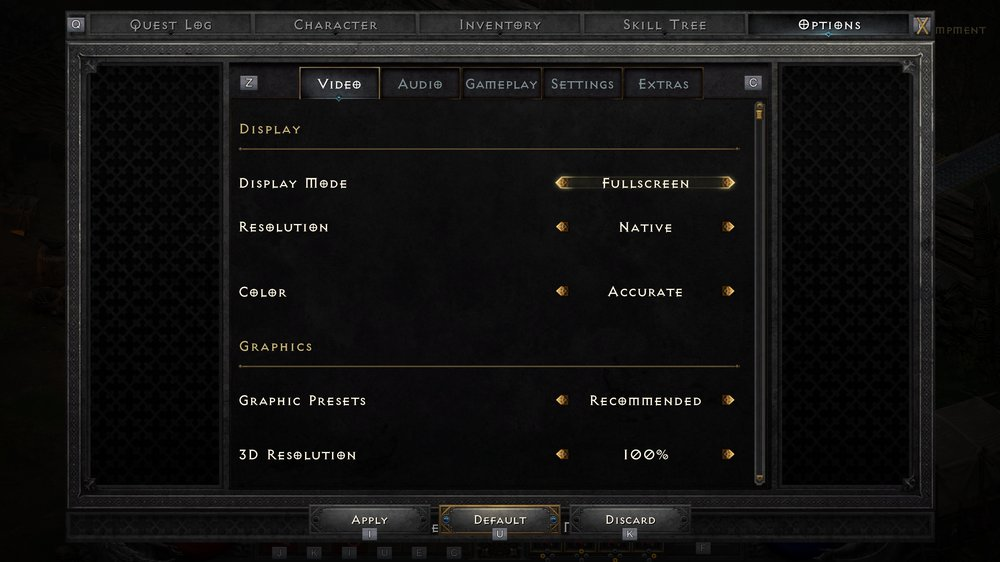
  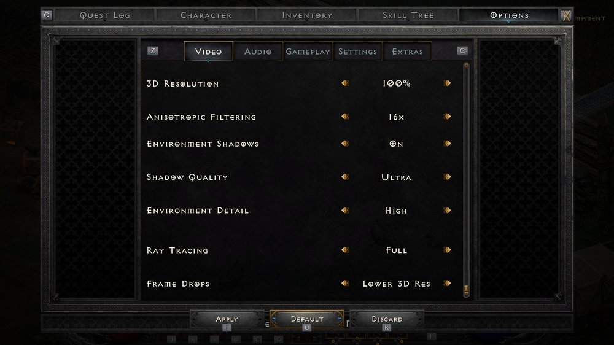
</p>

</details>

<details id="saves-you-can-trust">
<summary><b>Saves you can trust</b></summary>

Nothing hurts like a lost character, so saving got real attention.

- The Mac app saves whenever you quit, however you quit: from the Dock, at logout, even with a text box still open. Minimizing saves too.
- The iPhone app saves the moment it goes to the background, so swiping it away loses nothing.
- If a save can't be written (a full disk, say), the game tells you, and the next save still goes through. One failure can never quietly block the rest.
- A damaged shared stash can't jam iCloud sync.
- **iCloud sync** works between iPhones and iPads, and with a Mac app you build and sign yourself with a paid developer account. The Mac app from the launcher keeps its saves on the Mac; moving a character over by hand takes a minute ([docs/MAC.md](docs/MAC.md#saves-logs-and-icloud)).

</details>

<details id="the-game-as-it-shipped">
<summary><b>The game as it shipped</b></summary>

**D2R Metal changes the platform, not the game.** Drop rates, the economy, skills and their caps, the stash, the automap and the difficulties are exactly what Blizzard shipped. No mods, no balance changes, no added systems. The only touch to the game's logic is the piece of a community fix that lets it run offline.

A few quality-of-life switches live on the **Extras** tab of Options, each one off if you want it off: light beams on valuable drops, item notes, potion pickup and belt refill, and a buzz on valuable drops on iPhone. New games start beside the town waypoint, and the pause menu has a **Quick Restart** for your farming runs.

</details>

<details id="questions-and-answers">
<summary><b>Questions and answers</b></summary>

**Is this an emulator?** No. The game's own code, from the Switch release, runs directly on your Apple chip. The handful of instructions a normal app can't run are rewritten once, ahead of time, and the graphics are rebuilt on Metal 4. Nothing is emulated and nothing is streamed.

**Why the Switch version?** Because it's the Arm build of the game, which is what Apple silicon speaks. You need your own copy and its update, dumped from your own console with its keys ([docs/GAME_FILES.md](docs/GAME_FILES.md)).

**I own it on Battle.net. Can I use that?** Not with D2R Metal, which is built on the Switch release. On a Mac, CrossOver runs the PC version.

**Can I play online?** No. D2R Metal is single player, offline, forever yours.

**Will I get ray tracing?** On a Mac with an M3 or later and at least 16 GB, the game turns it on where it estimates you'll hold 60 fps. On any other M3-or-later Mac you can turn it on yourself. iPhone and iPad don't have it yet.

**How do updates work?** The launcher watches this project's releases, updates the game and itself, and can roll back. The game's main menu also lets you know when something new is out.

**Coming from D2R Mobile?** Your saves load straight in. Items kept in its extra stash space (the wider columns, extra pages, Pouch or vault) don't carry over.

</details>

<details id="for-developers">
<summary><b>For developers</b></summary>

<details>
<summary>How it works</summary>

1. An offline step rewrites a few instructions in the game's aarch64 program so it can run as an ordinary process (no code is generated at run time, which iOS forbids).
2. A native host loads it, provides the Switch system services it calls, and runs it on the device's CPU.
3. The game's NVN graphics calls are replayed on Metal 4, with its shaders translated offline to Metal.

A tour of the code is in [dm/README.md](dm/README.md).

</details>

<details>
<summary>Built to be measured</summary>

Every change is checked before it lands, and the numbers below come from runs that can be repeated. One command runs the checks in tiers, from a few seconds of source checks to long soak runs: `dm/verify/fork_gate.sh` ([dm/verify/FORK_GATE.md](dm/verify/FORK_GATE.md)). Picture-neutral changes are checked against tick-identical replays, FLIP pixel comparisons of this Mac's Recommended, the iPhone's and the original pictures, and structural checks of the interface pages; costs are measured with alternating A/B runs.

The tools in the repository:

- a **control port** to drive a running game, and a **scenario runner** that plays scripted sessions on the command-line host, the Mac App, the iOS app on a Mac, or an iPhone ([control_port.md](dm/verify/control_port.md), [scenarios](dm/verify/scenarios/README.md));
- **checks that read the game's own state**: the panels on screen, the focused widget, the controller actions as the game names them, and the save system, where a save that never commits is a failure; every scripted session also checks that its saved game would load;
- **baselines recorded from this project's own build**: three routes replay tick for tick, the replayed saves match the recorded ones byte for byte, and key screens are compared;
- **save fault tests** (a full disk at different moments, a quit in the middle of a save), a **playtest bot** that checks invariants after every action, and long **soak** runs;
- **A/B benchmarks** with statistics, regression checks against a kept build, sampled profiles per game thread and function, per-pass GPU timing, and **frame capture and replay**;
- **sanitizer builds** (ASan, UBSan, TSan), seeded **random exploration** with shrinking, **replay**, and LLDB commands that read the game's panels, focus and saves ([debugging.md](dm/verify/debugging.md)).

Measured on Apple hardware:

- **Mac with an M6, frame generation and ray tracing** (Mac App in front, full screen, 2560 × 1440, 2026-11-06): the game draws 30 frames and shows 60. Presenting without the display link, as Apple's frame interpolation guide does, took late images from 15 to 0 over four 24 s runs in town with rays off, and from 58 to 3 (discarded images 48 to 0) in a 52 s walk through the Cathedral with rays on. Input to picture is about 96 ms against 73.5 at real 60 (two runs of 26 trials, rays off). Rays at Full take about 11 ms more GPU time per drawn frame in the Cathedral, measured at full clock.
- **iPhone 17 Pro, the same with presents on their own queue** (3D at 50%, alternating runs, 30 s counted, 2026-11-06): late images in town from 1.7–1.9% to 0.06–0.11%, real frames discarded from about 30 to none, and a crowd of 100 monsters from 24 fps to about 54. A 5.5-minute walk at thermal state 2 had 5 late images of 19,200. The image follows its frame's start by 56 ms against 50 with the display link.
- **iPhone 17 Pro, what each picture size costs** (3D at 50%, own GPU time under a fixed added load): 2622 × 1206 23.5 ms, 1952 × 900 13.7, 1640 × 754 10.2, 1568 × 720 9.3, 1280 × 590 7.1, which fit 1.4 + 7.0 ms per megapixel. Below 720 rows the HUD loses its orb and belt art.
- **Slower iPhones, simulated on the iPhone 17 Pro** (each device's picture size, plus added GPU work to reach its estimated time; [debugging.md](dm/verify/debugging.md)): 60 fps in town with at most 2 late images in 30 s on every tier. A crowd of 100: 55 fps at the iPhone 16 Pro's settings, 44 at the iPhone 12's. The CPU isn't slowed.
- **Mac, the costs behind the settings** (M6, 12 GPU cores, alternating runs, before frame generation): the 3D at 75% takes about the same GPU time as a 1920 × 1080 picture with MetalFX; letting rendering passes overlap saves 0.54 ms (−8.5%); skipping repeated state binds cuts bind records by 57% and the replay thread's instructions by 13%; Ultra shadows take about 0.59 ms more shadow-pass time than Standard. This GPU lowers its clock when it has room, so these are relative sizes on this machine, not costs for slower Macs.
- Not measured yet: any Mac slower than the M6; any iPhone or iPad other than the iPhone 17 Pro; battery and heat on phones over long sessions; and the shadow settings on a phone.

</details>

<details>
<summary>History</summary>

- D2R Metal began in October 2026 as a fork of D2R Mobile. Its first changes went back upstream (four were adopted in D2R Mobile v2.0); since 2026-10-28 it is developed on its own, for Apple platforms only.
- **1.0** (2026-10-31) is the first release, with D2R Metal Launcher for the Mac. Releases are listed on the [releases page](https://github.com/PowerBeef/d2r-metal/releases).
- **1.1** (2026-11-02) plays with a mouse and keyboard as D2R does on PC: the game's own PC interface, gauntlet pointer and PC keys; a controller brings the console interface back.
- **1.2** (2026-11-03) picks the picture settings for your Mac from its chip and screen.
- **2.0** (2026-11-06) brings ray tracing, MetalFX Temporal and frame generation, and a steadier picture.
- `main` is the trunk. Changes are checked by the project's own gate ([dm/verify/FORK_GATE.md](dm/verify/FORK_GATE.md)); see [CONTRIBUTING.md](CONTRIBUTING.md).

</details>

</details>

---

## Legal

**You must own the game, including the Reign of the Warlock expansion.** This is an independent, non-commercial project. It is not affiliated with, endorsed by, or sponsored by Blizzard Entertainment, Nintendo or Apple. Diablo and Blizzard Entertainment are trademarks of Blizzard Entertainment, Inc.; Nintendo Switch is a trademark of Nintendo; Apple, Mac, iPhone, iPad, Metal and MetalFX are trademarks of Apple Inc. Use it only with a copy of the game that you own. The banner, section plates, buttons and icon on this page are original artwork made for this project; they use no art from the game. The screenshots and clips show the game running in D2R Metal; they live with this page in `docs/images` and are not part of any release.

<details id="acknowledgements">
<summary><b>Acknowledgements</b></summary>

D2R Metal exists because of **[D2R Mobile](https://github.com/jhaizhou-ops/d2r-mobile)** by [@jhaizhou-ops](https://github.com/jhaizhou-ops) and its contributors, who built the port: the original program running unchanged, touch controls, controller support and five languages. Their acknowledgements, including the community authors of the Android and HarmonyOS ports, are in upstream's README.

The project stands on the open-source work below. Thank you to its authors and maintainers.

- **Ryujinx** (Ryubing Canary 1.3.351, MIT): `dm/third_party/ryujinx` bundles its shader translator unchanged (the Ryujinx.Graphics.Shader, Spv.Generator and Ryujinx.Common projects), which translates the Switch game's shaders to SPIR-V.
- **deko3d** (fincs, devkitPro, zlib): the texture layout size algorithm in `dm/gfx/nvn/nvn_tex.c` is ported from it; the file carries deko3d's notice.
- **nvn.h** (h1k421, MIT): the graphics API declarations in `dm/gfx/nvn/include/nvn.h`.
- **nxnative** (seedds, MIT): GPU timestamps, the 120 Hz display-link timing, the Metal compile cache, the shader bounds guard, NVN frame capture and replay, the function-map and fuzzing tools are adapted from it; each adapted file says so in its header.
- The full texts of these two licenses are in [dm/third_party/notices](dm/third_party/notices), and every release pack that carries the adapted code carries them too.
- **libdeflate** (Eric Biggers, MIT): decompressing game data.
- **bcdec** (iOrange, MIT or Unlicense): decoding BC textures on devices that do not support the BC formats.
- **FLIP** (NVIDIA, BSD 3-Clause): the image difference metric used in image-quality checks.
- **Offline fix patch** (LFS Mod Offline Fix): the two rewrites in `dm/tools/patch_nso.py` that let the game run offline come from this community patch, whose original author is not reliably recorded. Its two other byte patches change game logic and are left out.
- Tools used to build and verify: SPIRV-Cross, XcodeGen, .NET, Capstone and Unicorn, Pillow, numpy, lz4, astcenc, hactool, libimobiledevice and LLVM. Versions and links are in [docs/DEPENDENCIES.md](docs/DEPENDENCIES.md).

</details>

## License

MIT, see [LICENSE](LICENSE) (Copyright (c) 2026 jhaizhou; Copyright (c) 2026 the d2r-metal contributors). Third-party code keeps its own license in its own directory; see [docs/DEPENDENCIES.md](docs/DEPENDENCIES.md).
